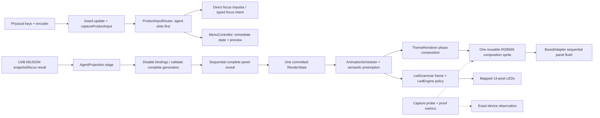

# Phase 03.1: High-Fidelity Animation and Interaction Polish - Research

**Researched:** 2026-08-21  
**Domain:** Embedded C++ rendering, bounded animation, physical input/LED feedback, and exact-device visual profiling  
**Confidence:** HIGH for repository architecture and contracts; MEDIUM for final timing/power budgets because they must be measured on the connected unit

<user_constraints>
## User Constraints (from CONTEXT.md)

### Locked Decisions

### Theme motion signatures
- **D-01:** Motion is selective, clear, and restrained. Improve animation that already exists and add new motion only where it strengthens hierarchy or feedback; not every element or state needs to move.
- **D-02:** The four themes use distinct motion metaphors rather than one shared pulse with different styling: Signal Edge should move like a rail/signal system, Ledger like a typographic record, Beacon like a field/beacon, and Instrument like a gauge or instrument.
- **D-03:** Ambient motion normally lives in accents around stable content. Titles, state words, values, and primary semantic forms remain readable and spatially stable. Metaphor-appropriate glyph motion, such as a rotating ring, is allowed when it does not weaken the cue.
- **D-04:** Each theme defines its own intentional set of animated and static agent states. Research and planning must inventory every relevant state and document why its treatment fits that theme; do not force one state-motion matrix across all themes.

### Transition choreography
- **D-05:** Ordinary live-data replacement uses a short semantic transition. Stale, offline, SYNC, safety fences, and other urgent truth changes assert immediately rather than waiting for decorative motion.
- **D-06:** Transitions share one bounded timing and interruption contract across themes, while their visible choreography follows each theme's rail, row, field, or gauge metaphor.
- **D-07:** Encoder-menu navigation uses spatial slide and scroll behavior: rotation direction is reflected in row motion, and root/detail navigation has a clear spatial relationship. Brightness preview updates continuously without decorative delay.
- **D-08:** Menu input feedback is immediate. Animation may accompany rotation, click, confirmation, close, cancel, timeout, and brightness preview, but it must never gate input handling or delay the first visible response.
- **D-09:** Failure fences appear immediately. Once a fresh complete generation is ready, recovery uses a short per-panel, theme-specific staged reveal; existing binding fencing remains in force until the complete safe commit.

### Focus and encoder feedback
- **D-10:** An agent-key press produces an immediate, very short tactile visual impulse before entering pending. The impulse confirms the physical press only and must not imply that Herdr accepted the focus.
- **D-11:** Pending uses localized continuous theme-specific motion, such as a spinner, sweep, traveling accent, or equivalent. Identity and state text remain fixed.
- **D-12:** Exact-focus success remains brief and snappy, with a short theme-specific flourish around the existing approximately 800 ms hold. Rejected, vanished, uncertain, and failed outcomes remain clearly visible for the longer bounded failure hold or until newer authoritative data supersedes them.
- **D-13:** Encoder behavior follows direct physical causality: every detent moves one row immediately, click responds immediately, confirmation visibly settles into the stored value, and cancel or timeout visibly reverses an unconfirmed preview. Do not add inertial or momentum scrolling.

### LED/display coordination and acceptance
- **D-14:** Display and LED motion synchronize at shared semantic moments, including blocked pulse, press, pending, success/failure, menu-open, and health transitions. Decorative ambient accents may run independently; full frame-by-frame lockstep is not required.
- **D-15:** Preserve each LED grammar's restraint. Improve its existing pulses, traveling cues, and transitions without adding a universal resting breath; a grammar may remain dark or static where that is part of its language.
- **D-16:** Ordinary LED state, menu, and successful-focus changes may blend using grammar-appropriate transitions. Blocked, stale/offline health, rejection, failure, and uncertainty assert immediately rather than blending through an ambiguous intermediate state.
- **D-17:** Acceptance uses an exhaustive visual matrix. Capture every relevant tile state, source fence, focus-feedback state, SYNC screen, Codex screen, and menu/detail/brightness state in all four themes. Physically exercise all 16 theme/LED-grammar combinations through normal refresh, rapid encoder and agent-key input, live Herdr/Codex changes, stale/offline transitions, and reconnect/reset flows.
- **D-18:** Framebuffer captures prove logical pixels, geometry, clipping, overlap, palette, and composition. Exact-device observation separately proves physical brightness, LEDs, viewing behavior, optical artifacts, interaction feel, and smoothness; neither evidence type substitutes for the other.

### the agent's Discretion
- Choose exact per-theme primitives, easing curves, frame counts, transition duration within the shared bounded envelope, and which metaphor-appropriate glyphs may move.
- Choose exact capture organization, contact-sheet format, profiling instrumentation, and defect ledger format, provided every matrix cell and physical flow in D-17 has traceable evidence.
- Derive final cadence, frame-time, input-latency, dropped/degraded-frame, memory, and power budgets from mandatory exact-device measurements. Preserve the existing complete-frame, no-per-frame-allocation, semantic-preemption, half-cadence, and static-degradation constraints.

### Deferred Ideas (OUT OF SCOPE)

None — discussion stayed within phase scope.
</user_constraints>

## Summary

Phase 03.1 should be planned as a tracer-first firmware/presentation refinement, not as a new UI framework or a host protocol redesign. The production seam is already complete-frame composition into one reusable 128×128 RGB565 PSRAM sprite, followed by sequential `pushSprite` calls through `AgentProjection`; `ThemeRenderer` owns geometry, while `AgentProjection` owns source fencing, generation commit, feedback lifecycle, and flush order. [VERIFIED: firmware/src/app/agent_projection.cpp:49-58,565-608] The host bridge remains authoritative for normalized snapshots and typed focus results; animation must not alter its `agent_snapshot`, opaque identity, epoch/revision, or `focus_intent` boundaries. [VERIFIED: host/herdr_keypad/src/herdr_keypad/bridge.py:1-8]

The first implementation wave must add/extend measurement before selecting final cadence or easing. Existing `AnimationScheduler` has the 1.2 s BLOCKED epoch, Full/Half/Static levels, 30% duty decision, and allocation-free scheduling, but current theme implementations inherit the default zero ambient cadence and therefore do not yet supply the four distinct ambient signatures. [VERIFIED: firmware/src/ui/animation.h:5-16,21-40,67-94; firmware/src/ui/theme.h:47-56; firmware/src/ui/theme_signal_edge.cpp:149-253; firmware/src/ui/theme_ledger.cpp:73-231; firmware/src/ui/theme_beacon.cpp:185-313; firmware/src/ui/theme_instrument.cpp:152-291] Measure the connected device through the existing proof/capture protocol, then implement deterministic bounded phases in the existing seams and recapture every matrix cell.

**Primary recommendation:** instrument `AgentProjection`/`ProofMetrics` and exact-device input/flush evidence first; then extend `RenderState`/`ThemeRenderer` with bounded transition phase and per-theme ambient state, keep `MenuController` authoritative but add presentation-only progress, synchronize semantic LED epochs, and validate all 16 theme/grammar pairs with paired framebuffer plus physical observation evidence.

## Architectural Responsibility Map

| Capability | Primary Tier | Secondary Tier | Rationale |
|---|---|---|---|
| Complete tile/panel composition | Firmware display/render tier | `AgentProjection` commit tier | Themes draw into the shared sprite; projection owns complete-frame flush and panel selection. [VERIFIED: firmware/src/ui/theme.h:35-45; firmware/src/app/agent_projection.cpp:565-608] |
| Ambient and semantic animation scheduling | Firmware timing tier | Theme renderers | `AnimationScheduler` schedules bounded work and degradation; themes decide which slots/primitives are dirty. [VERIFIED: firmware/src/ui/animation.h:5-16,67-87; firmware/src/ui/theme.h:47-56] |
| Generation, freshness, and focus safety | Firmware projection + host bridge | USB protocol | `AgentProjection` fences bindings until complete commit; host bridge correlates opaque identity, host epoch, and revision. [VERIFIED: firmware/src/app/agent_projection.cpp:520-542; host/herdr_keypad/src/herdr_keypad/bridge.py:1-8] |
| Encoder/menu state and brightness authority | Firmware input/controller tier | Theme menu renderer; `BoardAdapter` hardware tier | `MenuController` clamps rows/values, persists only on confirmation, and emits immediate brightness intents. [VERIFIED: firmware/src/app/menu_controller.cpp:40-73,76-158,166-187] |
| LED grammar resolution and hardware writes | Firmware LED policy tier | `BoardAdapter`/`PhysicalMap` | Grammars emit bounded segments; `LedEngine` applies caps, health dominance, deduplication, and all-off mask writes. [VERIFIED: firmware/src/ui/led_grammar.h:11-64; firmware/src/ui/led_engine.cpp:18-107] |
| Exact-device logical and physical evidence | Host tooling + operator observation | Firmware capture/metrics seams | `capturePanel()` streams deterministic RGB565; physical observation is separately required for brightness, optics, LED output, feel, and smoothness. [VERIFIED: tools/capture_panel.py:90-133; .agents/skills/screen-capture-flow/SKILL.md:7-20] |

## Roadmap Success-Criteria Coverage

The roadmap defines five acceptance criteria rather than assigned requirement IDs. [VERIFIED: .planning/ROADMAP.md:248-261 — quote: “Success Criteria” and criteria 1–5]

| Roadmap criterion | Research-to-plan coverage |
|---|---|
| 1. Inventory every motion/static state | The state inventory below covers all tile states, feedback outcomes, source fences, Codex, menu, and brightness; each theme has an intentional animated/static set. |
| 2. Smooth/stable within resource and safety budgets | Measure compose+flush, key-poll gap, duty, degradation, heap/largest block, and reveal duration before locking cadence; preserve one complete frame and binding fencing. |
| 3. Responsive encoder and direct keys | Input path is already `board.update()` → `captureProductInput()` → `ProductInputRouter::route()` → dispatch; agent slots are emitted before encoder actions and never remapped by menu state. [VERIFIED: firmware/src/main.cpp:634-658; firmware/src/app/product_input_router.cpp:11-25] |
| 4. Hierarchy and truthful degraded/static modes | Stable identity/state/value text remains outside moving accents; urgent fences cut immediately; Static removes decorative motion but retains complete semantic frames. [VERIFIED: .planning/phases/03.1-high-fidelity-animation-and-interaction-polish/03.1-UI-SPEC.md:131-138,235-243] |
| 5. Exhaustive four-theme/four-grammar exact-device checks | Extend existing deterministic capture manifest/contact-sheet workflow and add a physical matrix for all 16 combinations, rapid input, concurrent source changes, fences, and recovery. [VERIFIED: .planning/phases/03.1-high-fidelity-animation-and-interaction-polish/03.1-UI-SPEC.md:247-265; tools/phase1_bringup/src/phase1_bringup/phase3_smoke.py:333-479] |

## Standard Stack

### Core (no new packages)

| Component | Version / pin | Purpose | Why use it |
|---|---|---|---|
| Arduino-ESP32 via pioarduino | Arduino `3.3.11`, ESP-IDF `5.5.5`, pioarduino platform `55.03.311` | Existing ESP32-S3 firmware runtime | The project pins the selected USB environment to the immutable pioarduino release and Arduino USB CDC flags. [VERIFIED: platformio.ini:6-21 — quote: `platform = https://github.com/pioarduino/platform-espressif32/releases/download/55.03.311/platform-espressif32.zip`, `-D ARDUINO_USB_MODE=1`, `-D ARDUINO_USB_CDC_ON_BOOT=1`] |
| LILYGO T-Keyboard S3 Pro library | Commit `c46c4cb5752c04bca417c1f959dac6f5acdb5142` | Four displays, keys, encoder, LEDs, panel abstraction | The existing board adapter is the only supported physical path; do not bypass its CS/LED/key mapping. [VERIFIED: platformio.ini:25-29; AGENTS.md:38-55] |
| LovyanGFX | `1.2.26` | Geometric primitives, text, RGB565 sprite | Existing themes compose only through `LGFX_Sprite`; no LVGL or second display abstraction. [VERIFIED: platformio.ini:26-29; .planning/phases/03.1-high-fidelity-animation-and-interaction-polish/03.1-UI-SPEC.md:16-26] |
| ArduinoJson | `7.4.3` | Existing bounded protocol/snapshot materialization | Phase 03.1 does not add protocol fields unless instrumentation proves an existing bounded path is insufficient. [VERIFIED: platformio.ini:28-29; firmware/src/app/agent_projection.cpp:306-457] |
| PlatformIO native + Unity | Native test environment; Unity `2.6.0` | Existing C++ seam tests | `native-agent-projection` already compiles projection, all four themes, all four grammars, menu, and router sources. [VERIFIED: platformio.ini:31-65] |
| Python standard library + pyserial tooling | Project target Python `>=3.11,<3.15`; current host reports Python `3.14.7` | Exact-pair capture, tracer, evidence manifest | Existing capture and phase smoke scripts use paired serial reconnect and bounded USB framing. [VERIFIED: AGENTS.md:42,60-64; tools/capture_panel.py:90-133] |

### Supporting surfaces to extend

| Surface | Existing contract | Phase 03.1 use |
|---|---|---|
| `AnimationScheduler` | `kBlockedPeriodUs` is `1200000UL`; `kBudgetPercent` is `30`; levels are `Full`, `Half`, `Static`. [VERIFIED: firmware/src/ui/animation.h:16-21 — quote: `enum class Level : uint8_t { Full = 0, Half, Static };`] | Add only bounded phase/progress/degradation observability required by measurements; never allocate or draw. |
| `ProofMetrics` | Records `max_display_flush_us`, `max_key_poll_gap_us`, heap/largest block, parser and queue high-water. [VERIFIED: firmware/src/metrics/proof_metrics.h:11-27] | Extend with cadence, animation duty, degraded/skipped-frame, reveal, and first-response measurements only if the existing metrics frame can carry bounded fields safely. |
| `capturePanel()` / `tools/capture_panel.py` | Deterministic scene values map to bounded `CAPTURE:panel:theme:scene`; streams `SCREENSHOT-RGB565\n` plus exactly `128*128*2` bytes. [VERIFIED: firmware/src/main.cpp:260-329; tools/capture_panel.py:14-23,90-133] | Add phase-indexed or transition fixture capture only without mutating NVS, active bindings, or host state. |

**Installation:** None. This phase must reuse the pinned firmware and existing host/tool dependencies; no external package is recommended or installed.

## Architecture Patterns

### System architecture diagram

The following is the existing call path and the planned animation seam, synthesized from the cited source paths. [VERIFIED: firmware/src/main.cpp:634-660; firmware/src/app/agent_projection.cpp:520-649; firmware/src/ui/led_engine.cpp:101-107]



### Component and call-path map

1. `setup()` loads the verified physical map/settings, installs the persisted theme/grammar, and sets the theme ambient period; `loop()` polls hardware first, routes agent keys before encoder actions, reads USB, ticks projection, refreshes menu, renders LEDs, samples metrics, and yields for 1 ms. [VERIFIED: firmware/src/main.cpp:612-660]
2. `AgentProjection::stageSnapshot()` validates closed bounded generation data; `commitSnapshot(board, panel4_theme, menu)` disables active bindings, flushes each agent panel sequentially, then commits bindings only after all three complete frames succeed. [VERIFIED: firmware/src/app/agent_projection.cpp:306-457,499-542]
3. `AgentProjection::tick()` handles pending/failure holds first, then asks the scheduler for BLOCKED/ambient work; fences suppress motion, feedback suppresses ambient motion for that slot, and each dirty panel is recomposed and flushed as a complete frame. [VERIFIED: firmware/src/app/agent_projection.cpp:611-649]
4. `AgentProjection::renderState()` is the single normalized view consumed by themes and LEDs, including source status, tile feedback, Codex source/values/age, diagnostics, and the shared BLOCKED phase. [VERIFIED: firmware/src/app/agent_projection.cpp:721-762; firmware/src/ui/render_state.h:5-76]
5. `LedEngine::render()` obtains one bounded grammar frame, applies global cap/resting/high-count/health rules, deduplicates unchanged writes, and uses one all-off mask write when needed. [VERIFIED: firmware/src/ui/led_engine.cpp:18-107]

### Pattern 1: Tracer-first profiling and evidence lock

**What:** Capture a baseline deployment identity, fresh exact-pair hello, proof metrics, and deterministic framebuffer manifest before changing animation. Preserve failed/degraded runs as typed evidence; do not infer smoothness from a logical framebuffer. [VERIFIED: tools/phase1_bringup/src/phase1_bringup/phase3_smoke.py:295-328,333-479; .agents/skills/screen-capture-flow/SKILL.md:7-20]

**Implementation sequence:**

1. Extend the existing metrics reply with bounded counters/maximums only if required: frame cadence, compose+flush duration, first visible press/encoder response, reveal duration, scheduler level, skipped/degraded frames, and allocation/high-water observations.
2. Run one exact-device baseline on the current binary using the paired `/dev/serial/by-id` identity; record binary hash, device/boot/session identity, metrics, and capture manifest.
3. Add deterministic phase fixtures to `CaptureScene` only for logical proof. Capture each phase representative in Full/Half/Static without changing NVS or committed bindings.
4. Implement the smallest theme/scheduler change, flash only the hash-bound binary, recapture the affected matrix, and add a defect ID for every mismatch.
5. Run physical observation on the same unit for viewing angle, brightness, LEDs, tearing/black flash/ghosting, smoothness, and input feel; close each defect with a traceable evidence ID.

**When to use:** Every animation change and every budget decision. This is the required phase decomposition, not a final afterthought.

### Pattern 2: Complete-frame semantic preemption

**What:** Urgent truth states and safety fences cut directly to a complete semantic frame. Ambient and ordinary transitions are interruptible and may be discarded when a newer generation or urgent fence arrives. [VERIFIED: .planning/phases/03.1-high-fidelity-animation-and-interaction-polish/03.1-UI-SPEC.md:110-138]

**Implementation shape:** Keep authoritative state and transition metadata separate from theme-local phase. On each frame, choose in order: `SYNC`/source fence, focus feedback or menu immediate response, ordinary transition for a current generation, then ambient accent; never blend stale/offline/SYNC through an intermediate color.

### Pattern 3: Presentation-only transition state

**What:** `MenuController` remains the input authority; animation adds only bounded presentation progress. Every detent mutates the cursor/candidate immediately and emits brightness in the same input turn; a later frame may visually settle/slide. [VERIFIED: firmware/src/app/menu_controller.cpp:123-158,166-187; firmware/src/main.cpp:636-643]

**Implementation shape:** Add a presentation record/timestamp at the projection/menu boundary rather than making the controller wait for an animation. Reversed detents cancel/reverse the visual phase. Close/cancel/timeout must call the existing `close()` path immediately so brightness restoration and panel-4 return cannot be held by animation.

### Pattern 4: Shared semantic epoch, grammar-owned choreography

**What:** Display and LEDs synchronize at press, pending, focus result, blocked, menu-open, health, and SYNC moments while each grammar retains its own resting language and phase. [VERIFIED: firmware/src/ui/led_grammar.h:18-22; firmware/src/ui/led_engine.cpp:29-63; .planning/phases/03.1-high-fidelity-animation-and-interaction-polish/03.1-UI-SPEC.md:187-198]

**Implementation shape:** Feed a shared event epoch or semantic phase into `RenderState`/`LedEvents`; let each grammar map it to bounded segments. Do not cross-couple LED grammar selection with theme renderer selection.

### Recommended project structure

```text
firmware/src/
├── app/agent_projection.{h,cpp}     # generation fence, feedback, phase arbitration, capture
├── app/menu_controller.{h,cpp}      # immediate menu/candidate state; presentation timestamps only
├── ui/animation.h                   # bounded scheduler, level, phase/degradation accounting
├── ui/render_state.h                # normalized semantic + bounded presentation fields
├── ui/theme.h                       # shared transition/ambient interface
├── ui/theme_signal_edge.cpp         # rail/signal choreography
├── ui/theme_ledger.cpp              # row/underline choreography
├── ui/theme_beacon.cpp              # field/beacon choreography
├── ui/theme_instrument.cpp          # ring/gauge choreography
├── ui/led_grammar_*.cpp             # four independent grammar phases
├── ui/led_engine.{h,cpp}            # caps, dominance, interpolation/application
└── metrics/proof_metrics.h          # physical timing/resource evidence

tools/
├── capture_panel.py                 # exact RGB565 deterministic/live capture
└── phase1_bringup/src/phase1_bringup/phase3_smoke.py
                                    # deployment, manifest, contact sheets, evidence

test/test_agent_projection/test_main.cpp
                                    # native projection/theme/menu/LED/scheduler seams
```

## Animation and State Inventory

### Shared semantic vocabulary

The firmware enums currently define four themes, four LED grammars, 17 tile states, and 10 feedback values. [VERIFIED: firmware/src/ui/render_state.h:10-29 — quote: `enum class ThemeId : uint8_t { SignalEdge = 0, Ledger, Beacon, Instrument };`, `enum class LedGrammarId : uint8_t { RailEcho = 0, Exception, FieldExtension, MeterLamps };`, `enum class TileState : uint8_t { Empty = 0, Blocked, Unseen, Working, Idle, Settled, Unknown, Stale, Offline, Unavailable, Sync, Pending, Focused, Rejected, Vanished, Uncertain, Failed };`, `enum class TileFeedback : uint8_t { Disabled = 0, Ready, Pending, Success, Rejected, Stale, Vanished, Offline, Uncertain, Failed };`] The UI contract requires every visible state to retain a literal word and geometric cue; motion is optional. [VERIFIED: .planning/phases/03.1-high-fidelity-animation-and-interaction-polish/03.1-UI-SPEC.md:154-157,235-243]

| State/family | Required treatment | Owner / implementation seam |
|---|---|---|
| `BLOCKED` | Existing shared 1.2 s high/low pulse; preserve as last animation to degrade and synchronize display/LED epoch. | `AnimationScheduler::blockedFrameDue()` / `blockedPulseHigh()`, `RenderState::blocked_pulse_high`, all grammars. [VERIFIED: firmware/src/ui/animation.h:46-64; firmware/src/ui/render_state.h:73-76] |
| `UNSEEN`, `WORKING` | Theme-specific accent motion may strengthen attention; identity/state word fixed. | Four concrete theme `composeTile()` paths plus theme phase. |
| `IDLE`, `SETTLED`, `UNKNOWN`, `EMPTY` | Intentionally static; retain geometric grammar and literal word. | Theme composition; no ambient dirty bit. |
| `PENDING` | Immediate press impulse first, then localized continuous cue; identity and state remain fixed. | `captureFocusIntent()`/`renderFeedback()` plus `AgentProjection::tick()` pending cadence. [VERIFIED: firmware/src/app/agent_projection.cpp:611-649; .planning/phases/03.1-high-fidelity-animation-and-interaction-polish/03.1-UI-SPEC.md:202-215] |
| `FOCUSED` / success | Short theme-specific flourish; existing success hold is `800000UL`. [VERIFIED: firmware/src/app/agent_projection.h:58-61 — quote: `static constexpr uint32_t kSuccessHoldUs = 800000UL;`] | Focus result application + theme feedback composition + grammar success cue. |
| `REJECTED`, `VANISHED`, `UNCERTAIN`, `FAILED` | Immediate assert; hold for failure bound or newer authoritative generation; never imply success or replay. | `applyFocusResult()`, feedback styles, LED semantic dominance. |
| `STALE`, `OFFLINE`, `UNAVAILABLE`, `SYNC` | Immediate static safety fence; disable action; no decorative blend. | Source status, `disableActive()`, `renderSync()`, theme fence composition. [VERIFIED: firmware/src/app/agent_projection.cpp:460-472,544-552; firmware/src/ui/theme_common.h:75-81] |
| Codex current/partial | Values, reset, limit, and age cut in truthfully; only bounded theme-appropriate settle around stable text. | `composePanel4()` in each theme; `RenderState::codex`. |
| Codex stale/offline/auth/unavailable | Immediate veil/reason; preserve cached values only under unmistakable fence; unknown/null is `N/A`, not zero. | Shared `theme_common` Codex helpers + per-theme panel 4 composition. [VERIFIED: firmware/src/ui/theme_common.h:134-219] |
| Menu root/detail/brightness | Immediate first response; optional 120–200 ms spatial settle; no input gating. | `MenuController`, `AgentProjection::renderMenu()`, theme menu primitives. |
| Reconnect/recovery | All-panel SYNC until complete validated generation; staged per-panel reveal ≤250 ms; bindings stay fenced through final flush. | `commitSnapshot(board, panel4_theme, menu)`. [VERIFIED: firmware/src/app/agent_projection.cpp:520-542] |

### Theme motion signatures

| Theme | Animated states / motion metaphor | Intentionally static states and fences | Concrete seam to extend |
|---|---|---|---|
| Signal Edge | Rail/signal dash phase; `BLOCKED` rail pulse; `UNSEEN` stripe advance; `WORKING` directional sweep; localized `PENDING` rail cue; `FOCUSED` check flourish. | `IDLE`, `SETTLED`, `UNKNOWN`, `EMPTY`; stable title/state/value; stale/offline/SYNC/fail cut immediately. Existing rail is x=0..15 and BLOCKED currently changes offset between 0 and 6. [VERIFIED: firmware/src/ui/theme_signal_edge.cpp:31-57,149-189] | Add deterministic phase input to `drawRail`, feedback glyph, and bounded accent helpers; override `ambientPeriodUs()`/`ambientTick()` only after profiling. |
| Ledger | Restrained row/underline reveal/highlight travel; BLOCKED inversion-band pulse; `UNSEEN` double underline advance; `WORKING` underline sweep; pending header/row progress; focused underline/check settle. | Stable baselines, words, metadata, values; calm states and SYNC veil static; stale/offline header never animates. Current underline is the state channel and BLOCKED owns a 70..90 band. [VERIFIED: firmware/src/ui/theme_ledger.cpp:19-71,89-148,218-227] | Add phase to underline/highlight primitives without moving title rows or state baseline. |
| Beacon | Quantized low-contrast field breath/halo shift; BLOCKED field/glyph pulse; UNSEEN restrained halo; WORKING directional sweep; pending center sweep; focused beacon settle. | Calm states flat; fences/SYNC/unavailable use static stepped fields/reason. Current field is a bounded ordered-dither pass over x=6..122, y=0..95; pending spinner is 16-point. [VERIFIED: firmware/src/ui/theme_beacon.cpp:39-64,105-123,185-258] | Add a quantized phase table to field/glyph accents; never animate title strip or numeric values. Avoid increasing the O(128×96) field cost without measurement. |
| Instrument | Ring marker/tick sweep; BLOCKED dashed ring pulse; UNSEEN double-ring marker; WORKING gauge sweep; pending ring spinner; focused ring/check settle. | Calm states and fences use static bezel/veil; ring center, state word, title, and values fixed. Current ring center is `(64,54)` with radius 32 and 16-point bounded table. [VERIFIED: firmware/src/ui/theme_instrument.cpp:23-32,51-88,152-222] | Add deterministic marker index/phase to ring helpers; preserve corner bezel health channel and fixed text lines. |

### Codex and menu motion contract

Panel 4 is read-only Codex at rest and menu surface while open; all themes already own panel-4 geometry. [VERIFIED: firmware/src/app/agent_projection.cpp:651-662; firmware/src/ui/theme_signal_edge.cpp:192-243; firmware/src/ui/theme_ledger.cpp:150-216; firmware/src/ui/theme_beacon.cpp:261-301; firmware/src/ui/theme_instrument.cpp:224-270] Implement only presentation around stable values: usage rail/gauge settle for a current observation, one underline settle in Ledger, one low-contrast marker settle in Beacon, or one bounded gauge sweep in Instrument. Cut immediately for `STALE`, `OFFLINE`, `AUTH REQUIRED`, `UNAVAILABLE`, and null fields.

The root list is six bounded rows (`THEME`, `LEDS`, `BRIGHTNESS`, `HEALTH`, `ABOUT`, `CLOSE`), three-row viewport, clamped cursor, and 30 s inactivity. [VERIFIED: firmware/src/app/menu_controller.h:19-20; firmware/src/ui/theme_common.h:301-305; firmware/src/app/menu_controller.cpp:123-173] Add spatial progress as presentation-only state: a detent changes exactly one row/value immediately; a click opens/enters/confirms immediately; brightness emits a 10% step immediately and close/timeout restores stored brightness immediately. [VERIFIED: firmware/src/app/menu_controller.cpp:40-73,76-158,166-187]

## Four LED Grammars

The grammar interface is bounded (`LedSegment`, `LedEvents`, `frame(..., capacity)`), with `kLedGrammarMaxSegments = 8`; grammar selection remains independent of theme. [VERIFIED: firmware/src/ui/led_grammar.h:11-22,57-69]

| Grammar | Existing language and zones | Phase 03.1 guidance |
|---|---|---|
| Rail Echo | Backlights L1/L4/L7/L10/L13; tile state brightness is BLOCKED 40/10, UNSEEN 30, WORKING 18, IDLE 8; pending cyan 45, success lime 45, failure red blink; menu L13 cyan 25. [VERIFIED: firmware/src/ui/led_grammar_rail_echo.cpp:3-18,26-70] | Add bounded rail-aligned transitions and shared semantic event epoch. Preserve dark settled/unknown/empty and immediate health override. |
| Exception Channel | Above-key accents L0/L3/L6/L9 own health red 10; rest is intentionally dark except BLOCKED 30/8 and UNSEEN 20; feedback is a short pressed-zone blink; menu L13. [VERIFIED: firmware/src/ui/led_grammar_exception.cpp:3-6,18-57] | Do not add ambient breath or generic crossfade. Only improve the existing bounded blink/pulse and event alignment. |
| Field Extension | Three-LED halos K1=0..2, K2=3..5, K3=6..8; usage 9..11; health pair 12..13; pending advances one of the three LEDs every 300 ms. [VERIFIED: firmware/src/ui/led_grammar_field_ext.cpp:3-10,38-57,59-91] | Keep pending sweep localized and cadence shared with display pending cue; health pair immediately wins and disables halos. |
| Meter + Lamps | Backlights mirror Rail Echo; usage meter uses L0/L2/L3/L6 only when honest current usage exists; reached limit lights lamp set; inactive lamps remain dark. [VERIFIED: firmware/src/ui/led_grammar_meter_lamps.cpp:3-6,39-69,71-104] | Preserve “no data, no meter” and no universal life effect; ordinary usage transition may blend only after truth is current, while health/limit/failure assert. |

`LedEngine` enforces global brightness cap 45, dim cap 8, health cap 10, resting cap 25, at most six high-brightness LEDs, unchanged-write suppression, and all-off mask writes. [VERIFIED: firmware/src/ui/led_engine.h:1-52; firmware/src/ui/led_engine.cpp:41-99] Any interpolation must happen before this policy and remain allocation-free; it must never bypass semantic dominance.

## Resource, Timing, and Memory Constraints

The fixed UI contract sets the following targets: press impulse ≤80 ms target / 120 ms hard maximum; pending cue advances every 300 ms with a 3 s deadline; success hold 800 ms target / 900 ms hard maximum; failure hold 2 s; ordinary transition 200 ms target / 250 ms hard maximum; recovery reveal 200 ms target / 250 ms hard maximum; menu slide 160 ms target / 200 ms hard maximum; brightness 10–100% applies in the same turn; BLOCKED is a fixed 1.2 s cycle; animation duty must stay ≤30% of loop wall time. [VERIFIED: .planning/phases/03.1-high-fidelity-animation-and-interaction-polish/03.1-UI-SPEC.md:110-138]

The current scheduler computes projected duty from `flush_us * 100 / activePeriodUs()`, steps Full→Half→Static when over budget, and recovers Static→Half→Full only after comfortable margin. [VERIFIED: firmware/src/ui/animation.h:23-41] The current main loop feeds `tick_cost` with a fixed `1000` µs loop window, while `ProofMetrics` measures display flush and key-poll gap separately. [VERIFIED: firmware/src/main.cpp:647-658; firmware/src/metrics/proof_metrics.h:58-69] Planning must verify whether this approximation is sufficient for the final acceptance; do not silently call it a complete duty measurement. Prefer measured loop wall time / animation-specific flush spans in the new instrumentation.

Memory constraints are structural rather than guessed: the shared sprite is created once with PSRAM, 16-bit depth, and 128×128 dimensions; renderers use caller-owned bounded local scratch arrays and no per-frame allocation. [VERIFIED: firmware/src/app/agent_projection.cpp:49-58; firmware/src/ui/theme_signal_edge.cpp:99-120; firmware/src/ui/theme_common.h:103-122] The Beacon field is the main CPU-cost risk because it walks a 117×96 pixel region with RGB565 blending and dithering. [VERIFIED: firmware/src/ui/theme_beacon.cpp:39-64] Profile it independently before choosing a high cadence.

## Exact-Device Measurement and Visual Evidence

### Logical framebuffer evidence

Use the existing exact-pair `tools/capture_panel.py` path. It validates the pairing file and fresh hello firmware/protocol identity, sends a bounded `probe` capture request, checks `SCREENSHOT-RGB565\n`, reads exactly 32,768 RGB565 bytes, writes PPM and `.rgb565`, and decodes big-endian RGB565. [VERIFIED: tools/capture_panel.py:14-16,90-133] Deterministic scene names currently include all core tile states/fences/feedback, SYNC, Codex states, and menu root/detail/brightness scenes. [VERIFIED: tools/capture_panel.py:18-63; firmware/src/main.cpp:260-316]

The Phase 3 smoke tool already provides the correct evidence organization pattern: exact deployment hash/identity, one record per capture with theme/scene/panel/dimensions/hash, contact sheets, redaction result, and machine-vs-physical evidence kinds. [VERIFIED: tools/phase1_bringup/src/phase1_bringup/phase3_smoke.py:295-328,333-479] Extend this pattern for Phase 03.1 rather than inventing an unrelated artifact schema. Suggested capture groups:

- `tiles`: occupied BLOCKED/UNSEEN/WORKING/IDLE/SETTLED/UNKNOWN, empty 0–3-slot fixtures, all focus feedback/fences, and SYNC.
- `codex`: current/partial/stale/unavailable/auth/offline/host-offline/limit/long text.
- `menu`: six root cursor positions, theme/LED preview/confirm/revert, health/about, brightness 10/80/100 and transition endpoints.
- `motion`: deterministic phase samples for each animated state at Full, Half, and Static; each sample must retain the same semantic words and bounded geometry.
- `led`: machine-readable resolved LED segments per grammar/event phase, paired with the display capture/event epoch.

Inspect pixels for 128×128 dimensions, 4 px inset, rail/row/field/ring geometry, clipping, overlap, RGB565 palette, hatch/veil, fixed title/state/value positions, complete composition, and absence of mixed-generation binding. Framebuffer evidence cannot prove physical brightness, LED correctness, optics, viewing behavior, or smoothness. [VERIFIED: .agents/skills/screen-capture-flow/SKILL.md:7-20,117-166]

### Physical observation evidence

On the same paired unit, exercise all 16 theme/grammar combinations under ordinary refresh, rapid detents/clicks, rapid direct agent presses, concurrent Herdr/Codex updates, BLOCKED/pending/success/failure, stale/offline, reconnect, and reset. Record exact panel orientation, viewing angle, brightness/legibility, LED zones, blend artifacts, tearing, black flashes, ghosting, subjective smoothness, first visible press latency, encoder response latency, key-poll gap, complete compose+flush, animation duty, cadence/degraded frames, heap/largest block, queue high-water, zero-allocation evidence, semantic event alignment, and input starvation. [VERIFIED: .planning/phases/03.1-high-fidelity-animation-and-interaction-polish/03.1-UI-SPEC.md:247-265]

Use typed observation IDs and immutable artifact hashes in the evidence manifest. Keep failed and degraded runs; do not relabel them as passes. Existing Phase 3 evidence demonstrates the repository's operator-confirmed Y/pass shape and exact deployment linkage, including fresh device/session IDs and capture manifest hashes. [VERIFIED: artifacts/phase3/03-DEVICE-EVIDENCE.json:1-26,27-198]

## Likely File Changes and Test Seams

### Production files likely to change

- `firmware/src/ui/animation.h`: phase/cadence/degradation counters, proper measured duty input, interruption/reset semantics; retain `Full`, `Half`, `Static`, 30% rule, and BLOCKED-last degradation.
- `firmware/src/ui/render_state.h`: bounded presentation phase/event epoch/transition metadata shared by themes and grammars; do not duplicate host snapshot authority.
- `firmware/src/ui/theme.h`: transition input and optional phase/dirty-slot methods; preserve complete-frame composition ownership.
- `firmware/src/app/agent_projection.{h,cpp}`: arbitrate semantic transitions, ambient frames, focus impulse/pending/success/failure, staged reveal, event epoch, capture fixture phases, and measurements.
- `firmware/src/app/menu_controller.{h,cpp}`: only presentation timestamps/progress hooks if needed; preserve immediate cursor/value mutation and stored-value revert.
- `firmware/src/ui/theme_signal_edge.cpp`, `theme_ledger.cpp`, `theme_beacon.cpp`, `theme_instrument.cpp`: implement distinct deterministic motion signatures with stable semantic text/geometry.
- `firmware/src/ui/led_grammar_*.cpp`, `led_engine.{h,cpp}`: bounded interpolation/phase mapping and shared semantic epoch; preserve grammar selection and policy caps.
- `firmware/src/metrics/proof_metrics.h`, `firmware/src/main.cpp`, and bounded protocol metrics serialization: expose final timing/degradation/resource evidence.
- `tools/capture_panel.py` and `tools/phase1_bringup/src/phase1_bringup/phase3_smoke.py`: add phase-aware capture/evidence organization without arbitrary serial selection or unbounded frames.

### Native tests to extend/add

The native environment already compiles all phase seams and uses Unity. [VERIFIED: platformio.ini:44-65] Existing tests prove one push per panel/sequential ordering, generation fencing, feedback holds, all four theme vocabulary/dispatch, scheduler BLOCKED cadence and degradation, LED policy caps/health/focus precedence, and menu/grammar masks. [VERIFIED: test/test_agent_projection/test_main.cpp:265-357,361-395,429-518,706-738,1227-1287,1334-1648]

Add behavior tests that fail on plausible regressions:

1. Scheduler phase table: Full samples every intended phase, Half samples every second phase, Static produces neutral semantic frame and no ambient flush; urgent fence cancels transition immediately.
2. Transition interruption: newer generation and stale/offline/SYNC preempt ordinary transition without queued old frame; bindings remain disabled until final staged flush.
3. Per-theme static/animated inventory: each theme animates only its assigned states and preserves stable title/state/value text and geometry across phase samples.
4. Focus latency semantics: direct key dispatch precedes encoder/menu action in simultaneous input; first press frame is observable before pending; success only follows exact accepted result; uncertain/failure never retries.
5. Menu causality: each detent mutates one row/value immediately, reversed detent reverses phase, click/timeout reverts candidate and brightness without waiting for animation.
6. LED semantic epochs: display and grammar receive the same event epoch; health/rejection/failure/uncertainty assert immediately; Exception remains dark at rest; Meter + Lamps remains dark without honest usage.
7. Bounded resource instrumentation: no per-frame allocation, segment/capture capacity remains bounded, and metrics fields stay valid through the existing protocol.

The phase intentionally skips host behavior changes unless instrumentation/evidence cannot be represented through the existing bounded metrics path; host tests should remain unchanged for authority/focus semantics. [VERIFIED: host/herdr_keypad/src/herdr_keypad/bridge.py:1-8]

## Don't Hand-Roll

| Problem | Do not build | Use instead | Why |
|---|---|---|---|
| Display abstraction / panel sequencing | A second TFT/LVGL/TFT_eSPI/raw-CS renderer | Existing `ThemeRenderer` + `AgentProjection` + board `Display` path | The project contract requires complete frames and board-owned panel access; the shared sprite and sequential flush already enforce the seam. [VERIFIED: firmware/src/ui/theme.h:35-45; firmware/src/app/agent_projection.cpp:565-608] |
| Motion scheduler | Per-theme timers, heap queues, or free-running loops | One `AnimationScheduler` with bounded phase and semantic preemption | Existing scheduler already owns cadence, BLOCKED epoch, and degradation. [VERIFIED: firmware/src/ui/animation.h:5-16] |
| Input arbitration | Theme-local key handlers or menu modal interception | `captureProductInput()` + `ProductInputRouter` + existing dispatch | Router emits all three agent slots before encoder actions and menu never owns the agent-key path. [VERIFIED: firmware/src/main.cpp:636-643,574-583; firmware/src/app/product_input_router.cpp:11-25] |
| Host authority / focus identity | Slot lookup, optimistic success, queue/replay | Existing opaque binding + host epoch/revision + `FocusExecutor` path | The bridge explicitly preserves opaque pane identity and typed focus only. [VERIFIED: host/herdr_keypad/src/herdr_keypad/bridge.py:1-8; AGENTS.md:15-22] |
| LED power/safety policy | Grammar-specific bypasses or universal breath | `LedEngine::resolve/apply` caps and dominance | Central policy enforces brightness/resting/high-count/health/all-off behavior. [VERIFIED: firmware/src/ui/led_engine.cpp:41-99] |
| Pixel capture | Camera screenshots for geometry or ad hoc serial reads | Paired `capture_panel.py` exact RGB565 stream | Logical framebuffer evidence must be exact and pairing-bound; camera is reserved for physical optics/brightness observation. [VERIFIED: .agents/skills/screen-capture-flow/SKILL.md:7-20; tools/capture_panel.py:100-133] |
| Evidence schema | Unhashed screenshots or free-form pass notes | Existing deployment/capture/evidence manifest with hashes and typed observations | Phase 3 tooling already binds captures to deployment and keeps machine/physical evidence distinct. [VERIFIED: tools/phase1_bringup/src/phase1_bringup/phase3_smoke.py:333-479] |

## Common Pitfalls

### Pitfall 1: Treating current scheduler duty as final measured animation duty

**What goes wrong:** The loop currently feeds `tick_cost` against a fixed 1000 µs window, while a complete animated panel flush may span a different wall-time window. [VERIFIED: firmware/src/main.cpp:647-653]  
**How to avoid:** Add explicit animation compose+flush and loop-window measurements before locking cadence; report both raw maxima and projected duty.  
**Warning signs:** Static mode never triggers despite visible input gaps, or Full mode appears acceptable in native tests but misses the 30% physical budget.

### Pitfall 2: Adding motion by moving semantic text or identity

**What goes wrong:** Titles, discriminator, state word, Codex values, and age become hard to read or semantically ambiguous. The contract requires stable text/value positions. [VERIFIED: .planning/phases/03.1-high-fidelity-animation-and-interaction-polish/03.1-UI-SPEC.md:141-169,235-243]  
**How to avoid:** Animate only rails, underlines, fields, markers, rings, and feedback vehicles; capture phase endpoints to verify fixed baselines.

### Pitfall 3: Letting a decorative transition delay a fence or binding state

**What goes wrong:** Stale/offline/SYNC can blend through a current-looking frame, or a key can remain actionable during progressive reveal. [VERIFIED: firmware/src/app/agent_projection.cpp:520-542,611-649]  
**How to avoid:** Source fence and `disableActive()` precede composition; urgent state wins first frame; commit bindings only after every panel flush.

### Pitfall 4: Menu animation intercepts direct keys

**What goes wrong:** Encoder menu becomes modal and violates the core three direct focus paths. [VERIFIED: firmware/src/main.cpp:636-643; firmware/src/app/product_input_router.cpp:11-25]  
**How to avoid:** Keep router/dispatch ordering untouched and test simultaneous agent press + click/rotation from root, detail, brightness, health, and about.

### Pitfall 5: LED interpolation bypasses grammar restraint or truth policy

**What goes wrong:** Exception Channel gains an unintended resting breath, Meter + Lamps shows usage without honest current data, or health red blends through a misleading current state. [VERIFIED: firmware/src/ui/led_grammar_exception.cpp:26-57; firmware/src/ui/led_grammar_meter_lamps.cpp:39-104; firmware/src/ui/led_engine.cpp:29-63]  
**How to avoid:** Interpolate only grammar-approved ordinary transitions; assert health/rejection/failure/uncertainty immediately through `LedEngine` dominance.

### Pitfall 6: Beacon frame cost causes input starvation

**What goes wrong:** The radial field's per-pixel RGB565/dither pass consumes the loop budget and grows key-poll gaps. [VERIFIED: firmware/src/ui/theme_beacon.cpp:39-64; firmware/src/metrics/proof_metrics.h:25-26]  
**How to avoid:** Measure Beacon separately, prefer quantized low-cost phase tables or static/half cadence, and never skip key polling or semantic feedback.

### Pitfall 7: Logical capture is mistaken for physical proof

**What goes wrong:** RGB565 proves pixels but not LED output, brightness, glare, orientation, viewing angle, tearing, ghosting, or feel. [VERIFIED: .agents/skills/screen-capture-flow/SKILL.md:13-20]  
**How to avoid:** Pair every logical capture group with same-unit physical observation IDs and retain failed/degraded runs.

## Environment Availability

| Dependency | Required by | Available | Version / evidence | Fallback |
|---|---|---|---|---|
| Python | Capture/evidence tooling | Yes | `3.14.7`; project guidance is `>=3.11,<3.15`. [VERIFIED: AGENTS.md:42] | Use supplied `tools/phase1_bringup/.venv/bin/python3` where available; do not switch interpreter silently. |
| ffmpeg | Optional contact-sheet/PNG conversion | Yes | `8.1.2` observed in this session | Python PPM/PNG helpers in phase3 smoke remain a fallback. |
| PlatformIO CLI (`pio`/`platformio`) | Build/upload and exact-device flash | Not found on PATH in this session | Existing `.pio` artifacts and pinned `platformio.ini` exist, but no CLI executable was observed | Planner must include an environment checkpoint or invoke the project-supplied tool environment; this is a blocking dependency for flashing new firmware, not for native source planning. |
| Exact paired keypad | Physical profiling/capture | Yes | `/dev/serial/by-id/usb-Espressif_USB_JTAG_serial_debug_unit_8C:BF:EA:0D:CB:FC-if00`; pairing binding present | None for exact-device acceptance; logical/native work can proceed, but final physical gate waits for exclusive serial access. |
| Serial bridge ownership | Capture and live host flows | Must be exclusive | Skill requires stopping bridge before direct capture/upload. [VERIFIED: .agents/skills/screen-capture-flow/SKILL.md:24-41] | Use `host/herdr_keypad/scripts/ensure-bridge.sh stop-for-acceptance`, then restart only after capture. |

**Missing dependencies with no fallback:** PlatformIO executable/tool environment is not available on PATH for a flash/upload step; exact-device implementation acceptance cannot complete until the pinned project environment is invokable.  
**Missing dependencies with fallback:** None for logical capture generation after firmware is flashed; existing Python helpers can decode/build contact sheets.

## Validation Architecture

Nyquist validation is explicitly disabled in `.planning/config.json`, so no mandatory validation architecture section is required for this phase. [VERIFIED: .planning/config.json:96-105 — quote: `"nyquist_validation": false`]

The existing native Unity seams remain the recommended focused checks when implementation begins: `native-agent-projection` compiles the projection, menu, router, four themes, four grammars, and ArduinoJson; the default native environment separately covers protocol. [VERIFIED: platformio.ini:31-65] Exact-device proof is not replaced by native tests and must use the paired capture/observation matrix above.

## Security Domain

Security enforcement is enabled at ASVS level 1. [VERIFIED: .planning/config.json:121-125 — quote: `"security_enforcement": true`, `"security_asvs_level": 1`]

| ASVS category | Applies | Phase control |
|---|---:|---|
| V2 Authentication | No new device authentication | Preserve host-side credentials and exact pairing/hello validation; animation must not add credentials or auth UI. [VERIFIED: AGENTS.md:20-22; tools/capture_panel.py:100-115] |
| V3 Session Management | Yes at boundary | Do not alter boot/session/host epoch/revision correlation; capture and metrics remain bounded to the existing session. [VERIFIED: host/herdr_keypad/src/herdr_keypad/bridge.py:1-8; tools/phase1_bringup/src/phase1_bringup/phase3_smoke.py:295-328] |
| V4 Access Control | Yes | Direct keys can emit only the existing typed focus action for a current binding; menu/animation cannot create arbitrary actions. [VERIFIED: AGENTS.md:15-22; firmware/src/main.cpp:514-528] |
| V5 Input Validation | Yes | Preserve bounded frame admission, closed enums, scene/metric allowlists, and no unbounded capture payload. [VERIFIED: firmware/src/main.cpp:260-316,470-496; firmware/src/app/agent_projection.cpp:306-457] |
| V6 Cryptography | No new cryptographic design | Do not add a second transport/auth scheme; retain existing exact pairing and hash-bound evidence. [VERIFIED: .agents/skills/screen-capture-flow/SKILL.md:34-41; tools/phase1_bringup/src/phase1_bringup/phase3_smoke.py:343-350] |

**Threat patterns:**

- Mixed-generation or stale binding exposure is an authorization/tampering risk; mitigate with stage-time disable and post-flush commit fencing. [VERIFIED: firmware/src/app/agent_projection.cpp:520-542]
- Malformed or oversized probe/metrics input is an input-validation/resource risk; retain bounded protocol admission and fixed scene allowlists. [VERIFIED: firmware/src/main.cpp:260-316,470-496]
- Animation-induced input starvation is a denial-of-service-style availability risk; measure key-poll gap and preempt decorative work before input or semantic feedback. [VERIFIED: firmware/src/metrics/proof_metrics.h:25-26; .planning/phases/03.1-high-fidelity-animation-and-interaction-polish/03.1-UI-SPEC.md:131-138]
- Evidence contamination or arbitrary serial selection can attach proof to the wrong device; retain exact pair/hello/hash binding and bridge exclusivity. [VERIFIED: tools/capture_panel.py:100-115; .agents/skills/screen-capture-flow/SKILL.md:34-41]

## Tracer-First Decomposition for Planning

### Wave 0 — measurement and evidence contract

- Add/confirm a bounded metrics schema for compose+flush, loop wall time, animation duty, frame cadence, skipped/degraded frames, scheduler level, reveal duration, first press/encoder response, key-poll gap, heap/largest block, queue high-water, and allocation evidence.
- Extend the exact-device tracer/evidence manifest with deployment identity, metrics snapshots, transition phase samples, LED event epochs, and a defect ledger; do not change authority or focus payloads.
- Capture a baseline from the current binary and preserve the current Phase 3 artifact lineage. The missing PATH `pio` executable is a checkpoint for later flash/upload, not a reason to guess final budgets.

### Wave 1 — bounded scheduler and projection arbitration

- Extend `AnimationScheduler` with deterministic phase sampling, interruption/reset, and measured budget accounting while preserving BLOCKED-last degradation.
- Extend `RenderState` and `AgentProjection` with presentation-only transition/event metadata; keep all fences, generation commit, and feedback deadlines authoritative.
- Add native tests for Full/Half/Static behavior, urgent preemption, one complete frame, no allocation, reveal fencing, and direct key priority.

### Wave 2 — four theme choreographies

- Implement Signal Edge rail/signal, Ledger row/underline, Beacon field/halo, and Instrument ring/gauge phase tables in their existing files.
- Keep semantic copy/identity/value baselines fixed; implement the explicit static state sets and immediate fence treatments.
- Add deterministic RGB565 phase fixtures and compare contact sheets before physical flash.

### Wave 3 — menu and focus interaction polish

- Add presentation-only menu slide/scroll/settle and focus press impulse/pending/success/failure flourish.
- Keep `MenuController` mutations immediate and direct keys first; test rapid/reversed detents, click/timeout revert, brightness preview, and simultaneous key+encoder input.

### Wave 4 — four LED grammar transitions

- Add bounded grammar-owned interpolation/travel cues tied to shared semantic event epochs.
- Preserve Exception darkness, Meter + Lamps no-data darkness, health immediate dominance, global caps, and one-mask all-off behavior.
- Add native segment/precedence tests and paired display/LED event evidence.

### Wave 5 — exact-device exhaustive acceptance

- Flash a hash-bound binary on the exact paired unit, stop bridge for direct capture, capture every logical matrix cell across themes/frames/modes, then run all 16 physical theme/grammar combinations and stress flows.
- Record measured final budgets and every defect ID. Accept only if all five roadmap criteria and D-17/D-18 evidence invariants are closed; otherwise retain a typed pending/blocking result for the next plan.

## Assumptions Log

| # | Claim | Section | Risk if wrong |
|---|---|---|---|
| A1 | Final animation cadence/easing and power budget can be selected after exact-device profiling rather than from existing source constants. [ASSUMED] | Summary / Resource constraints | A wrong hardware budget could force rework or unsafe thermal/brightness behavior; require Wave 0 measurement. |
| A2 | The existing bounded metrics envelope can carry the additional animation evidence without a protocol version change. [ASSUMED] | Tracer-first decomposition | If false, a separately planned bounded metrics extension/version update is required; do not smuggle fields into production snapshots. |

## Open Questions

1. **What are the measured baseline compose+flush and key-poll-gap distributions for each theme on the connected unit?**
   - Known: only maxima are currently exposed through `ProofMetrics`; Beacon has a heavier pixel field. [VERIFIED: firmware/src/metrics/proof_metrics.h:21-27; firmware/src/ui/theme_beacon.cpp:39-64]
   - Unclear: final cadence, frame-time budget, and power/brightness headroom.
   - Recommendation: Wave 0 records distributions or bounded buckets before selecting phase periods.
2. **Can the current `tick_cost`/1000 µs scheduler input represent true animation duty?**
   - Known: main loop currently passes `1000` as the loop window. [VERIFIED: firmware/src/main.cpp:647-653]
   - Unclear: whether display flush overlaps USB/input/LED work enough to make this projection conservative.
   - Recommendation: measure animation-specific complete compose+flush and real loop wall time; retain the old metric for compatibility until the new metric proves safe.
3. **Does the existing board/library build environment remain invokable from the project after source changes?**
   - Known: `pio` and `platformio` were not on PATH in this session, while `platformio.ini` pins the selected USB environment. [VERIFIED: platformio.ini:6-29; environment probe 2026-08-21]
   - Unclear: whether the supplied venv contains a usable PlatformIO executable.
   - Recommendation: add an explicit human/tool availability checkpoint before flash/upload.
4. **What physical optical artifacts appear at Full/Half/Static and at 10% brightness?**
   - Known: logical capture cannot answer this. [VERIFIED: .agents/skills/screen-capture-flow/SKILL.md:13-20]
   - Unclear: brightness linearity, ghosting, viewing-angle legibility, and subjective smoothness under each grammar.
   - Recommendation: record same-unit physical observations with immutable IDs and retain failures.

## Sources

### Primary (HIGH confidence)

- `.planning/phases/03.1-high-fidelity-animation-and-interaction-polish/03.1-CONTEXT.md` — locked decisions, existing seams, and acceptance boundary.
- `.planning/phases/03.1-high-fidelity-animation-and-interaction-polish/03.1-UI-SPEC.md` — exact geometry, motion timings, static/degraded contract, theme signatures, LED grammars, and evidence matrix.
- `.planning/ROADMAP.md:248-261` — Phase 03.1 goal and five success criteria.
- `firmware/src/app/agent_projection.{h,cpp}` — generation fencing, feedback lifecycle, complete-frame rendering, capture seam.
- `firmware/src/ui/{animation.h,theme.h,render_state.h,theme_common.h}` — scheduler, renderer seam, normalized state, shared vocabulary/palette.
- `firmware/src/ui/theme_{signal_edge,ledger,beacon,instrument}.cpp` — concrete geometry and current static/blocked/pending primitives.
- `firmware/src/ui/led_{grammar.h,grammar_rail_echo.cpp,grammar_exception.cpp,grammar_field_ext.cpp,grammar_meter_lamps.cpp}`, `led_engine.cpp` — grammar vocabulary and centralized policy.
- `firmware/src/main.cpp`, `firmware/src/app/{menu_controller,product_input_router}.{h,cpp}`, `firmware/src/metrics/proof_metrics.h` — input order, menu semantics, metrics.
- `tools/capture_panel.py`, `.agents/skills/screen-capture-flow/SKILL.md`, and `tools/phase1_bringup/src/phase1_bringup/phase3_smoke.py` — exact-pair RGB565 capture and evidence workflow.
- `test/test_agent_projection/test_main.cpp`, `platformio.ini` — native test seams and current assertions.

### Secondary (MEDIUM confidence)

- `AGENTS.md` stack/conventions and project constraints — pinned hardware/runtime recommendations and host authority boundary.
- `artifacts/phase3/03-DEVICE-EVIDENCE.json` — existing exact-device deployment/capture/evidence lineage and operator-confirmed observation format.

## Metadata

**Confidence breakdown:**
- Standard stack: HIGH — pinned in `platformio.ini` and project stack guidance; no new dependency proposed.
- Architecture: HIGH — concrete source paths and native tests directly inspected.
- Motion design: HIGH for required signatures/timing; MEDIUM for implementation primitive choice until device profiling.
- Resource/power budgets: MEDIUM — current constants are contracts, but final acceptance requires new exact-device measurements.
- Physical quality: LOW until the Phase 03.1 exact-device matrix is executed; logical captures cannot substitute for it.

**Research date:** 2026-08-21  
**Valid until:** 2026-09-20 for stable repository seams; revalidate timing, tool availability, and device evidence immediately before implementation acceptance.
