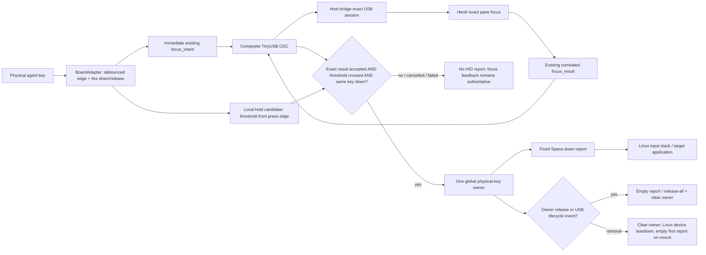

# Phase 03.2: Focus-Then-Hold USB Keyboard - Research

**Researched:** 2026-08-21
**Domain:** ESP32-S3 TinyUSB composite CDC + HID, focus-authorized physical hold state, exact-device qualification
**Confidence:** HIGH for repository authority/correlation; MEDIUM for composite behavior until the required exact-device gate runs

<user_constraints>
## User Constraints (from CONTEXT.md)

### Locked Decisions

### Gesture intent boundary
- **D-01:** Target one shared hold threshold in the **500–600 ms** range for all three agent keys. Finalize the exact value from physical measurements across all three keys, using the worst-case safe shared value rather than per-key thresholds.
- **D-02:** Measure the threshold from the debounced physical press edge already latched by firmware, not from focus-intent transmission or focus acknowledgment. Rendering and CDC workload must not lengthen the perceived gesture threshold.
- **D-03:** The press sends the existing exact focus action immediately. Space becomes eligible only when both conditions are true for the same continuously held key: the shared threshold has been crossed and the existing correlated focus action has succeeded.
- **D-04:** If the threshold is crossed before focus acknowledgment, remain armed while the key stays down and wait within the existing 3-second focus deadline. Do not add a shorter hold-specific deadline or require a second gesture solely because focus was slow.
- **D-05:** Release before authorization permanently cancels HID eligibility for that physical gesture. The original focus action continues normally, but a late result cannot revive the cancelled hold.

### Overlapping key gestures
- **D-06:** There is one global Space owner. While Space is active, other occupied agent keys retain immediate exact-focus behavior, but they cannot acquire or transfer the active Space state. The original owning key remains responsible for Space-up.
- **D-07:** Before Space becomes active, the newest sequential agent-key press becomes the sole hold candidate and cancels the older candidate's HID eligibility. Both presses remain ordinary exact focus actions with their existing correlation and result handling.
- **D-08:** If two agent keys are first observed down in the same hardware poll, treat the chord as focus-only. Arm no hold candidate until all agent keys have been released and a clean single-key gesture begins.
- **D-09:** Space ownership never transfers automatically. When the owning key releases, emit Space-up immediately even if another agent key remains held; that second key must be released and pressed again to start a new focus-authorized hold.

### Hold-state feedback
- **D-10:** Layer hold feedback onto the existing press, focus-pending, success, and failure vocabulary rather than replacing it with separate full-screen hold states.
- **D-11:** Use a microphone or equivalently clear voice-input symbol. After the threshold is crossed but focus is still pending, show an outlined or restrained pulsing mic on the candidate tile. On HID Space-down, change it immediately to a solid persistent mic and add the mapped grammar-specific active LED cue.
- **D-12:** Keep the solid active mic and LED cue on the physical owning key for the full Space-down lifetime, including after another agent key changes application focus. This cue identifies which physical release ends the keyboard state.
- **D-13:** Releasing after the threshold but before focus acknowledgment returns the tile directly to ordinary focus-pending feedback. Satisfy the visible-cancellation contract with one brief grammar-specific cue in the owning LED zone; do not interrupt the tile with a cancellation screen. A release before the threshold remains an ordinary focus-only press and does not need a hold-cancel cue.
- **D-14:** Existing focus failure-family presentation remains authoritative for rejected, stale, vanished, offline, uncertain, timeout, and failed outcomes. No failure may show the solid mic or active-Space LED state.

### Composite evidence gate
- **D-15:** Composite CDC + HID passes only when every applicable qualification row passes on one exact paired deployment: USB identity and pairing, bounded NDJSON CDC while HID is active, focus-to-HID ordering, short/hold separation, release and stuck-key safety, reconnect, suspend/resume, flashing, boot recovery, and input behavior. No open stuck-key defect or deferred applicable row is compatible with a pass.
- **D-16:** Preserve every first failure. Classify harness/setup failures separately from product failures, allow one bounded targeted diagnosis and correction, then rerun the complete affected gate from a clean boot. A reproducible product failure after that clean retest is the recorded composite rejection that may reopen alternative backends; do not iterate indefinitely.
- **D-17:** After deterministic lifecycle rows pass, run count-based automated mixed stress rather than a long manual soak. Exercise short presses, threshold crossings, delayed acknowledgments, early releases, overlapping keys, CDC traffic, and lifecycle interruptions; fail immediately on an invariant violation.
- **D-18:** One authorized hold produces one persistent HID Space-down state and one Space-up state. Firmware does not generate repeated Space taps and does not attempt to suppress operating-system or application key repeat; host repeat behavior is outside the device contract.

### the agent's Discretion
- Select the exact shared threshold within 500–600 ms from repeatable physical measurements, provided every key remains consistent and accidental holds are excluded by the evidence gate.
- Choose theme-specific mic geometry, pulse choreography, active LED treatment, and the brief cancellation LED duration while preserving semantic precedence, the existing animation budget, and all four independent LED grammars.
- Define the automated stress counts, ordering permutations, host-observation instrumentation, and bounded diagnosis procedure. Counts must expose races without turning qualification into an open-ended soak.
- Choose the TinyUSB composite descriptors, report cadence, and internal gesture-state organization after research. First test whether the existing correlated `focus_result` is sufficient authorization; add no protocol message unless evidence proves it insufficient.

### Deferred Ideas (OUT OF SCOPE)

None — discussion stayed within the fixed Space-only composite USB phase boundary.
</user_constraints>

<phase_requirements>
## Phase Requirements

| ID | Description | Research Support |
|---|---|---|
| HOLD-01 | “A short press on an occupied agent key retains the existing immediate exact-focus behavior and never emits a Space keyboard event.” | Keep immediate `focus_intent` emission at the existing press edge; arm a local candidate separately; gate short-click evidence on zero `KEY_SPACE` presses. [VERIFIED: .planning/REQUIREMENTS.md:30-36; firmware/src/main.cpp:575-593] |
| HOLD-02 | “A deliberate hold emits USB HID Space-down only after Herdr has acknowledged exact focus for the same action, opaque binding, host epoch, snapshot revision, and USB session, and only while that physical key remains held.” | Reuse the closed `focus_result` plus its admitted USB envelope; authorize only when `applyFocusResult()` returns success and the same candidate is still physically down and threshold-qualified. [VERIFIED: .planning/REQUIREMENTS.md:32-36; protocol/schema/v2.json:113-132; firmware/src/app/agent_projection.cpp:984-1021; firmware/src/protocol/protocol.cpp:940-992] |
| HOLD-03 | “Release before focus acknowledgment cancels the pending hold; stale identity, late result, focus failure, unavailable source, or disconnected host never emits Space.” | Candidate cancellation is monotonic for one gesture; the existing generation/action/identity/session fences already reject stale or cross-session results. [VERIFIED: .planning/REQUIREMENTS.md:32-36; firmware/src/app/agent_projection.cpp:527-572,955-1021; host/herdr_keypad/src/herdr_keypad/usb.py:124-185,208-240] |
| HOLD-04 | “Once Space-down is active, it behaves like a physical system keyboard across later focus changes and ends on physical release or USB-device removal; controlled reset and suspend paths release all keys.” | Give active Space ownership to a local physical-key state machine independent of later projection generations; centralize empty-report/release-all handling for release, stop, reset, suspend, resume, and next mount. [VERIFIED: .planning/REQUIREMENTS.md:32-36] [CITED: https://raw.githubusercontent.com/espressif/arduino-esp32/3.3.11/cores/esp32/USB.cpp] |
| HOLD-05 | “The exact keypad passes fresh composite CDC + HID qualification for USB identity, pairing, bounded NDJSON transport, reconnect, suspend/resume, flashing, boot recovery, input latency, and stuck-key behavior before recovery acceptance begins.” | Use the bounded gate and immutable evidence protocol below before production migration. [VERIFIED: .planning/REQUIREMENTS.md:32-36; .planning/ROADMAP.md:306-330; tools/phase1_bringup/src/phase1_bringup/qualification.py:108-159,245-301] |
| SAFE-02 | “The device can request only typed focus for its currently displayed binding and, after an acknowledged exact focus action, emit only the fixed USB HID Space hold defined by HOLD-01 through HOLD-04; it cannot invoke arbitrary Herdr methods, host commands, configurable keys, macros, text, or provider APIs.” | Keep the host protocol closed, add no key/config payload, and make the HID boundary expose only `spaceDown()`/`releaseAll()` rather than a generic key API. [VERIFIED: .planning/REQUIREMENTS.md:45-52; protocol/schema/v2.json:5-23,113-136] |
</phase_requirements>

## Summary

The exact stack can support the requested prototype, but it is a real USB-controller change rather than “add HID beside the current serial class.” The checked-in build has the exact flags `-D ARDUINO_USB_MODE=1` and `-D ARDUINO_USB_CDC_ON_BOOT=1`; Arduino-ESP32 uses mode `1` for the fixed USB Serial/JTAG controller, while its official composite example refuses mode `1` and runs TinyUSB only in USB-OTG mode `0`. The feasibility plan therefore needs a separate, non-production PlatformIO environment using the same pinned Arduino-ESP32 3.3.11 stack with `ARDUINO_USB_MODE=0`; it must instantiate CDC and keyboard interfaces before `USB.begin()`. Production `selected-usb` remains untouched until the complete gate passes. [VERIFIED: platformio.ini:6-30] [CITED: https://raw.githubusercontent.com/espressif/arduino-esp32/3.3.11/libraries/USB/examples/CompositeDevice/CompositeDevice.ino]

The existing `focus_result` is sufficient authorization. Its closed payload repeats `action_id`, `host_epoch`, `snapshot_revision`, slot, opaque entry/pane/terminal/session identity, `source_revision`, outcome, and `focused`; firmware accepts it only against its pending binding, while the frame envelope is already fenced by device boot, USB session, sequence, and duplicate/order checks. The host also suppresses completion if its focus generation, current USB session, or readiness changed. The planner should route the existing boolean success from `AgentProjection::applyFocusResult()` into the local hold candidate, not add a message or authorization field. [VERIFIED: protocol/schema/v2.json:113-136; firmware/src/app/agent_projection.cpp:955-1021; firmware/src/protocol/protocol.cpp:940-992; host/herdr_keypad/src/herdr_keypad/bridge.py:885-947]

**Primary recommendation:** Schedule one isolated TinyUSB mode-0 composite feasibility plan first, freeze its exact pass/fail manifest, and permit permanent transport/gesture migration only after every row passes on the currently paired LILYGO unit; a pass ends transport exploration, while only the immutable reproducible-product-failure path in D-16 may reopen alternatives.

## Architectural Responsibility Map

| Capability | Primary Tier | Secondary Tier | Rationale |
|---|---|---|---|
| Debounced press/down/release truth and timestamps | Firmware / board boundary | Exact hardware | `BoardAdapter` is the only hardware poll seam and already preserves the first debounced edge timestamp. [VERIFIED: firmware/src/board/board_adapter.h:9-56; firmware/src/board/board_adapter.cpp:43-75] |
| Immediate exact focus request and authorization | Firmware projection + host bridge | CDC session | `AgentProjection` captures the rendered binding; the bridge performs Herdr focus and returns the correlated closed result. [VERIFIED: firmware/src/main.cpp:575-593; firmware/src/app/agent_projection.cpp:955-1021; host/herdr_keypad/src/herdr_keypad/bridge.py:885-947] |
| Hold candidate and global Space owner | Firmware application state | Board + HID boundary | This is local gesture truth, not host/protocol state; active ownership must survive later projection changes but end on physical/lifecycle release. [VERIFIED: .planning/phases/03.2-focus-then-hold-usb-keyboard/03.2-CONTEXT.md:16-40] |
| HID report transfer and USB lifecycle | Firmware USB boundary / TinyUSB | Linux USB host | TinyUSB owns composite enumeration and report transfer; Linux externally observes keyboard state and teardown. [CITED: https://docs.espressif.com/projects/esp-idf/en/v5.5.2/esp32s3/api-reference/peripherals/usb_device.html] |
| Descriptor discovery and exact pairing | Host bridge / bring-up tooling | Firmware application hello | Descriptors discover candidates but do not authorize; the application hello and physical pairing remain authoritative. [VERIFIED: tools/phase1_bringup/src/phase1_bringup/discovery.py:1-104; tools/phase1_bringup/src/phase1_bringup/pairing.py:28-85] |
| CDC framing, sequence, reconnect | Existing firmware/host protocol session | TinyUSB CDC | The 4096-byte closed NDJSON/session path is already bounded and should be preserved through the controller change. [VERIFIED: protocol/schema/v2.json:1-23,123-136; firmware/src/protocol/protocol.cpp:940-992; host/herdr_keypad/src/herdr_keypad/usb.py:124-185,208-240] |
| Mic/LED hold feedback | Normalized firmware render/LED state | Four themes/grammars | Presentation consumes candidate/owner truth but cannot authorize HID. [VERIFIED: firmware/src/ui/render_state.h:5-97; .planning/phases/03.2-focus-then-hold-usb-keyboard/03.2-CONTEXT.md:29-35] |
| Feasibility decision and evidence | Host qualification harness | Exact firmware deployment | The existing manifest/hash/reopen architecture already separates machine facts, physical confirmation, recovery rows, and blocking failures. [VERIFIED: tools/phase1_bringup/src/phase1_bringup/qualification.py:20-159,245-385; tools/phase1_bringup/src/phase1_bringup/evidence.py:18-68,506-567] |

## Standard Stack

No new package installation is proposed, so a Package Legitimacy Audit is not applicable.

### Core

| Component | Version / pin | Purpose | Why this phase should use it |
|---|---|---|---|
| Arduino-ESP32 USB/TinyUSB | Arduino-ESP32 `3.3.11` via pioarduino `55.03.311` | Composite device, lifecycle events, CDC, HID | Already pinned by the project; the same version includes the official `CompositeDevice` example and public USB event APIs. [VERIFIED: platformio.ini:6-30] [CITED: https://github.com/espressif/arduino-esp32/tree/3.3.11/libraries/USB/examples/CompositeDevice] |
| `USB`, `USBCDC`, `USBHID`, `USBHIDKeyboard` | Bundled with Arduino-ESP32 3.3.11 | Device descriptors, CDC interface, return-aware HID transfer, standard keyboard descriptor | These are version-matched framework APIs; no third-party HID package or custom descriptor stack is needed. [CITED: https://raw.githubusercontent.com/espressif/arduino-esp32/3.3.11/cores/esp32/USB.h] [CITED: https://raw.githubusercontent.com/espressif/arduino-esp32/3.3.11/cores/esp32/USBCDC.h] [CITED: https://raw.githubusercontent.com/espressif/arduino-esp32/3.3.11/libraries/USB/src/USBHID.h] |
| T-Keyboard-S3-Pro Library | immutable commit `c46c4cb5752c04bca417c1f959dac6f5acdb5142` | One official board poll path and ButtonSense key state | Its checked source explicitly exposes `wasPressed()`, `wasReleased()`, and `isPressed()` from the cached STM32 key byte. [VERIFIED: platformio.ini:26-30] [CITED: https://raw.githubusercontent.com/Xinyuan-LilyGO/T-Keyboard-S3-Pro-Library/c46c4cb5752c04bca417c1f959dac6f5acdb5142/src/TKeyboardS3Pro.h] |
| Existing v2 NDJSON protocol | closed schema, max encoded line including LF `4096` | Snapshot, focus intent/result, session correlation | The exact existing frame types are quoted as `"agent_snapshot", "snapshot_ack", "focus_intent", "focus_result"`; the exact result outcomes are `"accepted", "rejected", "stale_target", "not_found", "herdr_offline", "timeout", "uncertain", "vanished", "failed"`. [VERIFIED: protocol/schema/v2.json:1-23,123-136] |

### Supporting

| Tool / seam | Available version | Purpose |
|---|---|---|
| Project-local PlatformIO | `6.1.19` | Isolated feasibility build/upload while retaining the production environment. [VERIFIED: environment probe 2026-08-21] |
| Python / existing Phase 1 tooling | Python `3.14.7`; existing pyserial environment | Freeze manifests, exact pairing, CDC traffic, monotonic measurements, atomic evidence. [VERIFIED: environment probe 2026-08-21; tools/phase1_bringup/src/phase1_bringup/qualification.py:78-180] |
| Linux `lsusb`, `udevadm`, `libinput`, sysfs/evdev | usbutils `019`, libinput `1.31.3` | Descriptor/interface observation, add/remove/reconnect, raw input timing and key state. [VERIFIED: environment probe 2026-08-21] |
| `dfu-util` | `0.11` | Manual boot/DFU recovery evidence if that exact application/boot path exposes DFU. [VERIFIED: environment probe 2026-08-21] [CITED: https://docs.espressif.com/projects/esp-idf/en/v5.5.2/esp32s3/api-guides/dfu.html] |

## Architecture Patterns

### System Architecture Diagram



### Recommended project seams

| Existing seam | Planning action | Non-goal |
|---|---|---|
| `platformio.ini` | Add an isolated feasibility environment with mode `0`; do not replace `selected-usb` until pass. Current exact production flags are `"-D ARDUINO_USB_MODE=1"` and `"-D ARDUINO_USB_CDC_ON_BOOT=1"`. [VERIFIED: platformio.ini:6-30] | No permanent transport cutover in the exploration task. |
| `BoardAdapter` | Extend its single `board_.update()` pass to latch/down-query debounced press and release truth for all three keys; keep the first press timestamp. [VERIFIED: firmware/src/board/board_adapter.cpp:43-75] | No raw STM32 read, second debounce path, or timer starting from CDC. |
| `ProductInputFrame` / router | Carry simultaneous down/release observations so same-poll chords are explicit; preserve agent-slot-before-encoder ordering. Current fields quote `agent_pressed`, `agent_latched_at_us`, `encoder_clicked`, and `encoder_delta`. [VERIFIED: firmware/src/app/product_input_router.h:5-44; firmware/src/app/product_input_router.cpp:11-35] | No menu remapping or generic gesture dispatcher. |
| `AgentProjection` | Keep it as binding/result authority; expose the accepted-result fact to the hold controller in the same dispatch turn. [VERIFIED: firmware/src/app/agent_projection.cpp:955-1021; firmware/src/main.cpp:402-414] | No second binding cache and no protocol-owned UI state. |
| Local hold controller | One fixed-capacity candidate plus one global owner; state keyed by physical slot, action ID, press-edge time, threshold state, authorization state, and cancellation generation. | No queue of holds, transfer, per-key threshold, dynamic keycode, or heap allocation. |
| Fixed HID boundary | Register the standard keyboard descriptor, expose only fixed Space-down and empty-report/release-all operations, gate on mount/HID readiness, and centralize lifecycle release. | No public `write(text)`, generic keycode, macro, or host command surface. |
| `UsbCdcLink` | Preserve its existing bounded `Serial` link. In mode `0` with CDC-on-boot, Arduino maps `Serial` to `USBSerial`; qualify rather than duplicate the transport class. [VERIFIED: firmware/src/transport/usb_cdc.cpp:5-39] [CITED: https://raw.githubusercontent.com/espressif/arduino-esp32/3.3.11/cores/esp32/HardwareSerial.h] | No new Wi-Fi or alternate backend. |
| Pairing/discovery | Gate with the measured composite descriptor tuple, then application hello and physical challenge. Current discovery is hard-coded to `EXPECTED_VID = 0x303A` and `EXPECTED_PID = 0x1001`, so it cannot discover the TinyUSB composite unchanged. [VERIFIED: tools/phase1_bringup/src/phase1_bringup/discovery.py:1-35] | Do not preserve the fixed-controller PID by impersonation merely to avoid a clean migration. |

### Focus result is sufficient authorization

1. The host frame envelope is admitted only after device boot ID, active USB session ID, sequence ordering, duplicate detection, and queue capacity pass. [VERIFIED: firmware/src/protocol/protocol.cpp:940-992]
2. The closed result payload exactly repeats action, generation, slot, full opaque binding identity, outcome, and `focused`. [VERIFIED: protocol/schema/v2.json:123-132]
3. `AgentProjection::applyFocusResult()` returns `true` only for exact correlation plus `outcome == "accepted"` and `focused == true`; every mismatch returns before clearing/authorizing. [VERIFIED: firmware/src/app/agent_projection.cpp:984-1021]
4. The host does not send a completed result after its focus generation, USB session, or ready state changed. [VERIFIED: host/herdr_keypad/src/herdr_keypad/bridge.py:921-947]
5. Therefore the hold controller needs no new wire fact. Store the candidate action ID locally when `captureFocusIntent()` succeeds; in `dispatchAdmission`, pass the admitted payload and the `applyFocusResult()` boolean to the candidate before rendering. A late result can still finish ordinary focus feedback, but a locally cancelled gesture remains ineligible. This is a planning conclusion derived from the four verified fences above.

### HID report pattern

`USBHIDKeyboard::press()` keeps a key in a persistent report until `release()` or `releaseAll()` sends a cleared report; `write()` deliberately emits a tap and is wrong for this phase. [CITED: https://raw.githubusercontent.com/espressif/arduino-esp32/3.3.11/libraries/USB/src/USBHIDKeyboard.cpp]

`USBHID::SendReport()` checks readiness, serializes report transmission, waits for the TinyUSB report-complete callback, and returns failure on not-ready, timeout, or send failure. The higher-level keyboard wrapper discards that boolean inside its `void sendReport`, so the feasibility prototype should prefer a narrow return-aware fixed-Space report boundary using the standard keyboard descriptor and `USBHID::SendReport()`; it must not expose the report buffer or keycode as configurable input. [CITED: https://raw.githubusercontent.com/espressif/arduino-esp32/3.3.11/libraries/USB/src/USBHID.cpp]

```cpp
// Source shape: Arduino-ESP32 3.3.11 official USB APIs.
// Constants are compile-time fixed; no payload supplies a keycode.
bool spaceDown();   // sends one standard keyboard report containing HID_KEY_SPACE
bool releaseAll();  // sends one empty standard keyboard report
bool ready();       // TinyUSB HID endpoint readiness
```

The planner should require the feasibility task to compile and physically prove the exact return-aware arrangement before treating a report as active. If the standard descriptor cannot be combined with return-aware fixed reports on this version without custom descriptor ownership, use `USBHIDKeyboard::press(KEY_SPACE)`/`releaseAll()` only inside the same narrow boundary and make the external stuck-key gate authoritative; do not add a package or a configurable HID layer.

## Bounded Composite Feasibility Gate

### Gate ordering

1. **Freeze before traffic.** Hash the manifest, exact board/application identity, pairing record digest, firmware binary, PlatformIO environment, USB descriptor expectation, observer versions, row counts, latency limits, and clean-boot/session IDs. Reuse the repository's atomic-write, SHA-256 sidecar, and reopen validation pattern. [VERIFIED: tools/phase1_bringup/src/phase1_bringup/qualification.py:108-180; tools/phase1_bringup/src/phase1_bringup/evidence.py:506-567]
2. **Keep production recoverable.** Build/flash only the isolated composite prototype; retain the last known current-CDC binary and verified manual BOOT/reset recovery procedure. Do not burn eFuses or make permanent hardware changes during feasibility. Arduino's official composite sketch uses application USB-OTG mode without requiring a custom stack. [CITED: https://raw.githubusercontent.com/espressif/arduino-esp32/3.3.11/libraries/USB/examples/CompositeDevice/CompositeDevice.ino]
3. **Run deterministic lifecycle rows first.** Enumeration/pairing, ordering/cancellation, lifecycle release, CDC load, flash/recovery, and latency must all pass before stress.
4. **Run the count-based mixed stress last.** The harness schedules result delay/outcome, CDC traffic, focus changes, and lifecycle commands; it machine-counts physical gestures and fails on the first invariant breach.
5. **Write one decision record.** `PASS` commits composite CDC + HID and closes transport exploration. `REJECT` is valid only after the D-16 reproducible-product-failure path. There is no “conditional pass,” deferred stuck-key row, or skipped applicable row.

### Exact pass/fail rows

| Row | Procedure | Pass condition |
|---|---|---|
| Build/controller | Compile the same pinned stack with `ARDUINO_USB_MODE=0`, CDC-on-boot, only CDC + standard keyboard HID; start interfaces before `USB.begin()`. | Clean build, flash, boot; no production `selected-usb` mutation; no extra HID usages/classes. [CITED: official CompositeDevice example URL above] |
| USB identity | Capture `lsusb -v`, udev properties, CDC stable link, HID stable link, VID/PID, serial, product/manufacturer, configuration/interface/endpoint descriptors after 5 software resets and 5 unplug/replugs. | One CDC and one keyboard HID interface every time; serial and product identity stable; no ambiguous second candidate; descriptor set hash stable. Espressif documents composite support and a maximum of six endpoints, so CDC + one HID is within the documented class envelope but still requires exact-device proof. [CITED: https://docs.espressif.com/projects/esp-idf/en/v5.5.2/esp32s3/api-reference/peripherals/usb_device.html] |
| Exact pairing | Perform a fresh physical challenge on the composite deployment, then reconnect through renumbered `/dev/ttyACM*`/input nodes. | Descriptor filtering only discovers; application hello matches the paired device; transient node changes do not authorize another device. [VERIFIED: tools/phase1_bringup/src/phase1_bringup/discovery.py:1-104; tools/phase1_bringup/src/phase1_bringup/pairing.py:28-135] |
| Threshold calibration | First record 30 intended short presses and 30 deliberate holds per physical agent key from the debounced edge. Evaluate 500, 525, 550, 575, and 600 ms offline; choose the lowest candidate with zero short crossings and successful deliberate activation on every key, then take the maximum per-key safe requirement as the one compiled shared value. Re-run 30 short + 30 hold gestures per key at the selected value. | One shared 500–600 ms value; zero accidental short crossings; all 90 final deliberate holds cross; operator records acceptable deliberate feel for all three keys. If no value meets all conditions, this row fails rather than creating per-key thresholds. |
| Immediate focus / short separation | For every final short gesture, allow both early and delayed accepted focus results. | Exactly one immediate focus intent with its original edge timing; zero `KEY_SPACE` press events/reports. [VERIFIED: firmware/src/main.cpp:575-593] |
| Focus-before-HID ordering | Run 30 ack-before-threshold and 30 threshold-before-ack holds per key. Host trace records Herdr outcome, complete `focus_result` write, evdev Space press, action ID, USB session, and monotonic times. | Space press never precedes both threshold crossing and exact accepted/focused result; if threshold wins first, activation waits within the existing `3000000UL` deadline, quoted from `kPendingDeadlineUs`. [VERIFIED: firmware/src/app/agent_projection.h:60-68] |
| Release-before-ack | Per key, run 20 release-before-threshold and 20 threshold-crossed-then-release-before-ack cases; send the otherwise-valid accepted result after release but before 3 s. | Focus may finish normally; HID stays up permanently for that gesture; late result never revives it. |
| Stale/failure/source/session | For each exact result outcome quoted above, plus wrong action, epoch, revision, slot, identity field, old boot, old USB session, duplicate, and out-of-order frame, run at least 10 cases while the key crosses threshold. | Zero Space presses. Failure feedback remains the existing family; no solid mic/active LED. Exact schema outcome quote and session rejection codes are source-verified. [VERIFIED: protocol/schema/v2.json:123-136; firmware/src/protocol/protocol.cpp:960-983] |
| Repeat behavior | Hold each key active for at least three configured Linux repeat delays, 10 times per key, with CDC traffic running. Observe evdev. | Exactly one `EV_KEY KEY_SPACE 1`, zero or more `EV_KEY KEY_SPACE 2`, then exactly one `EV_KEY KEY_SPACE 0`; no repeated value-1 press and no firmware tap train. Linux defines values `0` release, `1` press, `2` autorepeat. [CITED: https://docs.kernel.org/input/event-codes.html] |
| Active-owner independence | Activate A; while A remains held, press/focus B and commit later snapshots. Cover all six ordered A/B key pairs 5 times. Then release A while B remains held. | Space stays down across B focus/snapshots; cue stays on A; B never owns/transfers; A release emits up immediately; B must release/repress for a new hold. |
| CDC under HID | While Space is active, run the existing count-based final-maximum traffic (1,000 frames each direction) and 10 bursts of 100 frames, plus actual v2 snapshot/focus traffic. Include maximum-valid lines and one overlong-line rejection followed by a valid line. | Exact expected/sent/received/ack equality; zero unexpected reject, duplicate, out-of-order, malformed, digest, queue, or short-write failures; overlong line fails closed without poisoning the next valid line; HID state remains correct. The envelope limit is quoted as `4096` bytes including LF. [VERIFIED: protocol/schema/v2.json:1-5,134-136; tools/phase1_bringup/src/phase1_bringup/qualification.py:127-155,245-301] |
| Physical release | Release the owning key under idle and maximum CDC/display work, 30 times per key. | Host sees Space-up within the latency bound every time; owner/cue clears; no second up/down pair. |
| USB removal | Unplug while active 5 times; monitor udev and evdev; reconnect without touching any key. | Old input device is removed/cleared, no application remains logically held, new instance's first keyboard state/report is empty, and no hold reappears until every agent key is up followed by a new press. Linux input teardown is externally observed, not inferred from firmware logs. |
| Controlled reset | Trigger each existing controlled-reset path while active, 5 times. | A completed empty report is attempted before reset using the measured drain interval; after boot the first HID state is empty and focus keys remain fenced until authoritative sync. |
| Suspend/resume | Host-suspend the USB device while active, 5 times, then resume. | Suspend callback clears candidate/owner and attempts release-all; resume sends/observes an empty report before CDC/focus/HID rearming; a still-physically-held key cannot reactivate without release/repress. Arduino exposes exact events `ARDUINO_USB_SUSPEND_EVENT` and `ARDUINO_USB_RESUME_EVENT`. [CITED: https://raw.githubusercontent.com/espressif/arduino-esp32/3.3.11/cores/esp32/USB.h] |
| Reconnect/session | Interrupt CDC before focus result, reconnect exact device with a fresh session, then deliver/attempt the old result. Repeat 10 times. | Old session result is rejected; no queued/replayed focus or hold; fresh authoritative snapshot required before keys re-enable. [VERIFIED: host/herdr_keypad/src/herdr_keypad/usb.py:81-185,208-240] |
| Normal flashing | From the composite runtime, perform 5 ordinary uploads using the project toolchain and verify post-upload descriptor, fresh boot/session, CDC, HID-empty state, and app hello. | Every upload recovers without selecting a transient wrong device. TinyUSB CDC's checked source defaults reboot handling on and handles 1200-baud bootloader restart, but exact PlatformIO behavior remains a physical row. [CITED: https://raw.githubusercontent.com/espressif/arduino-esp32/3.3.11/cores/esp32/USBCDC.cpp] |
| Boot recovery | From a deliberately non-enumerating/broken application build, use the exact board's physical BOOT/reset procedure and restore the known-good image 5 times. | Recovery does not depend on the composite application being alive; restored app boots CDC + HID with empty keyboard state. Espressif documents manual BOOT + RESET entry for first USB flash. [CITED: https://docs.espressif.com/projects/esp-idf/en/v5.5.2/esp32s3/get-started/establish-serial-connection.html] |
| Input latency | Capture at least 100 authorized holds and 100 releases under idle and concurrent CDC/display work. Compute `eligible-to-down = evdev_down - max(threshold_cross, accepted_result_admission)` and `release-to-up`. | Target p95 ≤80 ms and hard max ≤120 ms for both, reusing the accepted direct-input responsiveness ceiling; no sample may be negative; press-edge-to-threshold error is bounded by measured maximum key-poll gap. [VERIFIED: .planning/phases/03.1-high-fidelity-animation-and-interaction-polish/03.1-04-PLAN.md:104-107; firmware/src/metrics/proof_metrics.h:97-102,146-152] |
| Mixed stress | After all rows above pass, run 300 machine-counted exact-device gestures: 90 short, 90 authorized holds, 30 delayed-ack threshold-first, 30 early releases, 30 overlapping/chord cases, and 30 stale/failure/session/lifecycle interruptions. Randomize with a recorded seed; run CDC bursts throughout. | Exact scheduled/observed counts, no invariant breach, no stuck Space, zero strict protocol failure counters. This is finite and replaces an unchanged long soak. |

### Stuck-key invariant

At every observation boundary, the harness maintains a two-state host oracle (`UP`/`DOWN`). Only an exact `KEY_SPACE value 1` may transition `UP→DOWN`; only value `0`, verified input-device teardown, or a freshly enumerated empty state may transition `DOWN→UP`; value `2` never changes the state. Any second press while `DOWN`, missing up by the hard latency bound, active state after reconnect/resume, or mismatch between firmware owner and host oracle fails immediately. [CITED: https://docs.kernel.org/input/event-codes.html]

### First-failure and bounded diagnosis protocol

- Preserve the first failing manifest/result/traffic/input trace and deployment hashes before any retry. Existing evidence code already validates immutable linkage. [VERIFIED: tools/phase1_bringup/src/phase1_bringup/evidence.py:30-68]
- Classify **harness/setup** only when a preflight itself is invalid: missing permission/tool, observer cannot see a known key transition, operator step was not performed, expected endpoint was not opened, or current known-good CDC control also fails. Correct the harness/setup and restart the row; this does not reject composite.
- Classify **product** when preflight passes and the exact composite deployment violates a frozen row in externally observed behavior.
- Permit one targeted diagnosis/correction for that product failure. Then clean-boot, establish a fresh USB/application session, and rerun the complete affected gate (including prerequisites and stress rows whose validity depends on it).
- If the same product invariant fails reproducibly, record composite `REJECT`; only that record may reopen alternative backends. If every row passes, record composite `PASS`, migrate permanently, and end transport exploration. These rules are locked by D-15/D-16 rather than inferred.

## Runtime State Inventory

| Category | Items found | Action required |
|---|---|---|
| Stored data | The pairing binding schema contains exactly `"schema_version": 1`, `device_id`, `protocol`, and `firmware`; it does not store VID/PID, serial descriptor, tty node, or HID node. The currently opened local record identifies device `0000fccb0deabf8c` and firmware `phase1-bringup`. [VERIFIED: tools/phase1_bringup/src/phase1_bringup/pairing.py:28-47; local pairing record read 2026-08-21] | The feasibility deployment must perform/record fresh composite pairing. A descriptor change alone needs no binding-schema migration; preserve or atomically replace the binding based on the application identity result. |
| Live service config | `UsbDeviceSession` defaults the binding file from `"~/.config/herdr/keypad-binding.json"` and owns one exact session; no external Herdr setting stores USB interface numbers in the inspected runtime. [VERIFIED: host/herdr_keypad/src/herdr_keypad/usb.py:33-60] | Stop the permanent bridge under its existing exclusive lock during qualification; reconnect only through the gate harness. No external service migration identified. |
| OS-registered state | The repository udev rule quotes `idVendor=="303a"`, `idProduct=="1001"`, serial `"8C:BF:EA:0D:CB:FC"`, and interface `"00"`; it is specific to the current fixed USB Serial/JTAG enumeration. [VERIFIED: host/udev/99-herdr-keypad.rules:1-4] | Do not broaden it. After composite pass, replace it with the measured CDC-interface rule and separately identify the paired HID input link. The standard live system rule location probe found no installed project rule in this session. |
| Secrets / environment variables | No credential or provider secret participates in USB descriptor, HID, or focus-result authorization; host credentials remain outside firmware by SAFE-01/SAFE-02. [VERIFIED: .planning/REQUIREMENTS.md:45-52] | No secret migration. Keep HID keycode and descriptors compile-time/configuration-local, never provider-controlled. |
| Build artifacts / installed packages | Production uses `selected-usb`; a project-local PlatformIO 6.1.19 exists, and no new library is required. [VERIFIED: platformio.ini:1-30; environment probe 2026-08-21] | Give the prototype a distinct environment/build artifact, retain the known-good binary for recovery, and delete/stop using the prototype artifact only after the decision record authorizes migration. |

## Don't Hand-Roll

| Problem | Don't build | Use instead | Why |
|---|---|---|---|
| Composite USB framework | A second TinyUSB fork or raw descriptors from scratch | Arduino-ESP32 3.3.11 `USB` + bundled CDC/HID classes | Version-matched stack already provides composite devices, endpoints, events, descriptors, and report completion. [CITED: Espressif USB Device Stack URL above] |
| Keyboard layout/macros | Text typing, configurable keycodes, macro interpreter | One private fixed Space report and empty report | SAFE-02 permits only Space; general keyboard APIs would enlarge authority. [VERIFIED: .planning/REQUIREMENTS.md:51-52] |
| Hold/debounce | Raw STM32/GPIO polling or a second debounce timer | Board library `isPressed()`/`wasReleased()` through `BoardAdapter` | The official board abstraction already advances ButtonSense from one cached STM32 key byte. [CITED: pinned TKeyboardS3Pro.h URL above] |
| Focus authorization | New `hold_authorized` message or second host RPC | Existing admitted exact `focus_result` boolean success | All required identity and session facts already exist and are checked. [VERIFIED: protocol/schema/v2.json:113-132; firmware/src/app/agent_projection.cpp:984-1021] |
| Repeat generator | Firmware timer sending Space taps | One persistent Space-down; Linux/application repeat | Linux already distinguishes press/repeat/release as values `1/2/0`. [CITED: https://docs.kernel.org/input/event-codes.html] |
| Pairing | First `/dev/ttyACM*` or HID node, VID/PID-only trust | Existing physical challenge + application hello + fresh session | Repository discovery explicitly says descriptors never authorize. [VERIFIED: tools/phase1_bringup/src/phase1_bringup/discovery.py:1-104] |
| Evidence | Mutable logs or manual “seemed okay” checklist | Frozen manifest, count equality, external evdev/udev trace, hashes, reopen validation | Existing qualification rejects PASS without complete counters, rows, metrics, and linkage. [VERIFIED: tools/phase1_bringup/src/phase1_bringup/qualification.py:245-301] |

## Common Pitfalls

### 1. Adding HID while leaving `ARDUINO_USB_MODE=1`
**What goes wrong:** The build remains on fixed USB Serial/JTAG, not programmable TinyUSB composite. **Warning sign:** the official composite example compiles its empty warning branch. **Avoidance:** isolate mode `0` feasibility and verify both interfaces externally. [VERIFIED: platformio.ini:19-22] [CITED: official CompositeDevice example URL above]

### 2. Treating `Keyboard.write(' ')` as a hold
**What goes wrong:** `write()` calls press then release, producing a tap. **Avoidance:** send one persistent down report and one empty/up report. [CITED: USBHIDKeyboard.cpp URL above]

### 3. Marking Space active without report-completion evidence
**What goes wrong:** `USBHIDKeyboard`'s higher-level calls do not expose the underlying `SendReport()` boolean. **Avoidance:** gate on HID readiness and use the return-aware fixed report seam where the versioned API permits; external evdev remains the acceptance oracle. [CITED: USBHID.cpp and USBHIDKeyboard.cpp URLs above]

### 4. Coupling active owner to projection generation
**What goes wrong:** `commitSnapshot()` clears every pending focus binding, so reusing projection pending state would cancel a legitimate active hold on later focus/snapshot changes. **Avoidance:** candidate authorization depends on projection, but active physical ownership is copied into its own local state until release/lifecycle. [VERIFIED: firmware/src/app/agent_projection.cpp:545-572]

### 5. Letting release-before-ack become eligible again
**What goes wrong:** A late valid result arrives after physical release and asserts Space. **Avoidance:** cancellation is monotonic for the gesture; action completion may update focus feedback but cannot rearm HID. This is locked by D-05.

### 6. Believing USB removal can transmit a final report
**What goes wrong:** Once the bus is gone, firmware cannot guarantee delivery. **Avoidance:** clear local owner on STOPPED/unplug, observe Linux device teardown, and require the first report/state after mount to be empty. Use controlled reset/suspend paths to release before or immediately after the lifecycle boundary when transfer is available. [CITED: USB.cpp URL above]

### 7. Reusing the current PID to avoid pairing work
**What goes wrong:** Current discovery's `0x303A:0x1001` identifies the fixed USB Serial/JTAG runtime, while the TinyUSB composite has a different descriptor identity. **Avoidance:** measure and lock the composite identity, then cleanly migrate discovery/udev after pass; descriptors remain discovery-only. [VERIFIED: tools/phase1_bringup/src/phase1_bringup/discovery.py:7-35; host/udev/99-herdr-keypad.rules:1-4]

### 8. Counting OS repeats as firmware presses
**What goes wrong:** evdev value `2` is misclassified as another down. **Avoidance:** require exactly one value `1`, allow zero or more value `2`, and require one value `0`. [CITED: https://docs.kernel.org/input/event-codes.html]

### 9. Testing only idle CDC or only firmware logs
**What goes wrong:** endpoint contention, display-induced polling gaps, and report loss remain invisible. **Avoidance:** run maximum bounded CDC and display/focus changes while HID is active, and observe from Linux input/USB surfaces. [VERIFIED: tools/phase1_bringup/src/phase1_bringup/qualification.py:127-156]

### 10. Infinite feasibility debugging
**What goes wrong:** exploration silently becomes migration and alternatives are reopened without a decision-quality failure. **Avoidance:** preserve first failure, one targeted correction, clean retest, then PASS or recorded product REJECT exactly as D-16 requires.

## Code Examples

### Version-matched composite startup order

```cpp
// Source: Arduino-ESP32 3.3.11 CompositeDevice example
#include "USB.h"
#include "USBHIDKeyboard.h"

USBHIDKeyboard keyboard;  // registers the standard keyboard descriptor

void setup() {
  USB.onEvent(usbEventCallback);
  USBSerial.onEvent(usbEventCallback);
  USBSerial.begin();
  keyboard.begin();
  USB.begin();             // start device only after interfaces are registered
}
```

[CITED: https://raw.githubusercontent.com/espressif/arduino-esp32/3.3.11/libraries/USB/examples/CompositeDevice/CompositeDevice.ino]

### Result-to-candidate ordering

```cpp
// Planning skeleton; uses existing payload/result, not a new protocol message.
const bool exact_focus_succeeded =
    agentProjection.applyFocusResult(payload.as<JsonObjectConst>());
holdController.observeFocusResult(
    payload.as<JsonObjectConst>(), exact_focus_succeeded, micros());
```

The existing implementation currently discards the boolean at the callsite, even though `applyFocusResult()` returns success only for the exact accepted/focused result. [VERIFIED: firmware/src/main.cpp:402-414; firmware/src/app/agent_projection.cpp:996-1021]

### Lifecycle release precedence

```cpp
// Planning skeleton: clear authority first; then attempt/verify an empty report.
holdController.cancelCandidate();
holdController.clearOwner();
fixedSpaceHid.releaseAll();
```

For resume/mount, the same empty report must complete before gesture rearming. This is a required ordering recommendation derived from HOLD-04 and the official STARTED/STOPPED/SUSPEND/RESUME callbacks. [VERIFIED: .planning/REQUIREMENTS.md:32-36] [CITED: USB.h/USB.cpp URLs above]

## State of the Art

| Current project approach | Phase 03.2 qualified approach | Impact |
|---|---|---|
| Fixed hardware USB Serial/JTAG, mode `1`, CDC only | Application TinyUSB USB-OTG mode `0`, composite CDC + standard keyboard HID | Enables HID but changes controller/enumeration, so pairing, flashing, recovery, and lifecycle need fresh qualification. [VERIFIED: platformio.ini:19-22] [CITED: Espressif USB Serial/JTAG and Device Stack docs] |
| Press-edge-only `BoardAdapter` latch | Same single poll/debounce path plus truthful current-down and release lifecycle | Hold threshold remains physical and render/CDC-independent. [VERIFIED: firmware/src/board/board_adapter.cpp:43-75] |
| Focus result used only for feedback | Same exact result also authorizes local fixed Space candidate | No wire expansion; host authority stays unchanged. [VERIFIED: firmware/src/app/agent_projection.cpp:984-1021] |
| Current udev/discovery fixed to `303a:1001`, interface `00` | Measured composite descriptors plus application identity and fresh pairing | Clean migration after pass; no first-node trust. [VERIFIED: tools/phase1_bringup/src/phase1_bringup/discovery.py:7-35; host/udev/99-herdr-keypad.rules:1-4] |

## Resolved Open Questions

1. **Is existing `focus_result` sufficient authorization?** Yes. Exact payload correlation plus admitted boot/session/sequence envelope and host generation/session suppression contain every HOLD-02 fact. No new message is justified. [VERIFIED: protocol/schema/v2.json:113-132; firmware/src/protocol/protocol.cpp:940-992; firmware/src/app/agent_projection.cpp:984-1021; host/herdr_keypad/src/herdr_keypad/bridge.py:921-947]
2. **Must the current CDC implementation be replaced before feasibility?** No. Build a separate mode-0 environment and preserve production; only after PASS migrate `selected-usb` and discovery/udev. [VERIFIED: .planning/ROADMAP.md:316-330]
3. **Who owns key repeat?** The host. Firmware sends one persistent down and one up; Linux value `2` repeats are allowed and not new presses. [CITED: USBHIDKeyboard.cpp; https://docs.kernel.org/input/event-codes.html]
4. **What exact threshold should planning encode?** The range and selection method are resolved; the numeric value is intentionally an output of the exact-device calibration row, not a research guess. The planner must gate later implementation plans on that recorded value.
5. **How is removal safe when no final USB transfer is possible?** Clear firmware owner on STOPPED, require Linux teardown to clear observed input, and require an empty first report/state on remount; controlled reset/suspend additionally attempt release while/when transfer is available. [CITED: USB.cpp URL above]
6. **What reopens alternatives?** Only the immutable reproducible composite product failure after one targeted correction and clean affected-gate rerun. A PASS ends transport exploration. This is locked by D-15/D-16 and Roadmap lines 316-323.

No unresolved prerequisite blocks planning. The exact threshold and descriptor tuple are deliberate feasibility outputs with closed measurement procedures, not open design questions.

## Environment Availability

| Dependency | Required by | Available | Version / observed identity | Fallback |
|---|---|---:|---|---|
| Exact LILYGO/ESP32-S3 runtime | Physical composite gate | Yes | Current USB enumeration `303a:1001`; stable link resolves to `ttyACM0`; paired application ID `0000fccb0deabf8c`. [VERIFIED: local probes and pairing record 2026-08-21] | None; exact board is mandatory. |
| Project-local PlatformIO | Build/flash | Yes | `6.1.19` | Use the project-local executable, not missing global `pio`. |
| Python | Evidence harness | Yes | `3.14.7` | None needed. |
| Herdr | Real focus authorization | Yes | `0.8.2` | None; installed Herdr is required. |
| Codex CLI | Existing host runtime context, not the HID gate | Yes | `0.149.0` | Not required for isolated composite rows. |
| `lsusb` / `udevadm` | USB identity/reconnect | Yes | usbutils `019`; udevadm present | sysfs is secondary observation, not identity authority. |
| `libinput` | Input observation | Yes | `1.31.3` | Direct existing evdev node observation if libinput cannot expose the required raw values. |
| `evtest` | Optional convenience observer | No | — | Not required; do not add a package solely for it. Use installed libinput/evdev and udev. |
| `dfu-util` | DFU/manual recovery row if applicable | Yes | `0.11` | Physical BOOT/reset plus ordinary project uploader as the exact board dictates. |
| Global `esptool.py` | Optional manual recovery convenience | No | — | PlatformIO carries its upload toolchain; do not install a new package for planning. |

**Missing dependencies with no fallback:** None identified for planning. Physical USB suspend and manual recovery require an operator checkpoint during execution, not a missing tool.

**Missing dependencies with fallback:** Global `pio`, `evtest`, and global `esptool.py` are absent; the project-local PlatformIO, installed libinput/evdev, and existing upload toolchain cover the required gate.

## Security Domain

Security enforcement is enabled and Nyquist validation is explicitly disabled. Accordingly, this research includes security controls and intentionally omits a Validation Architecture section. [VERIFIED: .planning/config.json:96-125]

### Applicable ASVS categories

| ASVS category | Applies | Standard control |
|---|---|---|
| V2 Authentication | Yes, device pairing boundary | Physical challenge plus opaque application hello; USB descriptors discover but never authorize. [VERIFIED: tools/phase1_bringup/src/phase1_bringup/discovery.py:1-104; tools/phase1_bringup/src/phase1_bringup/pairing.py:88-135] |
| V3 Session Management | Yes | Fresh boot/session IDs, monotonic sequence, duplicate/order rejection, close/discard on reconnect. [VERIFIED: firmware/src/protocol/protocol.cpp:940-992; host/herdr_keypad/src/herdr_keypad/usb.py:124-169,208-240] |
| V4 Access Control | Yes, primary risk | Firmware can request only exact typed focus and emit only compile-time fixed Space after exact success; no arbitrary methods/keys/text/macros. [VERIFIED: .planning/REQUIREMENTS.md:51-52; protocol/schema/v2.json:5-23,113-132] |
| V5 Input Validation | Yes | Closed schema, `additionalProperties: false`, bounded identifiers, max 4096-byte encoded line, strict digest/session/order admission. [VERIFIED: protocol/schema/v2.json:1-28,113-136] |
| V6 Cryptography | No new cryptographic protocol | Keep existing physical pairing and SHA-256 evidence integrity; do not claim USB HID/CDC is cryptographically authenticated. [VERIFIED: tools/phase1_bringup/src/phase1_bringup/evidence.py:18-68] |
| V7 Error/Logging | Yes | Preserve typed failures and first failure without credentials, transcript, or arbitrary payload; fail closed on uncertain result. [VERIFIED: .planning/REQUIREMENTS.md:25-28,51-52] |
| V13 API/Web Service | Limited local protocol | Only the four quoted v2 frame types exist; device rejects wrong direction and unknown fields. [VERIFIED: protocol/schema/v2.json:5-23; firmware/src/main.cpp:402-419] |

### Threat patterns

| Threat | STRIDE | Mitigation / gate |
|---|---|---|
| Spoofed accepted focus result triggers keyboard | Spoofing / Elevation | Exact pairing, boot/session/sequence envelope, action/generation/full-binding match, accepted+focused boolean. |
| Replayed late result revives released gesture | Replay / Elevation | Monotonic local cancellation plus duplicate/order/session fences; dedicated late-result row. |
| Generic key or text injection | Elevation / Tampering | Private fixed-Space boundary; no wire keycode, text, macro, or public generic key API. |
| Stuck Space creates denial of input | Denial of Service | One owner, return-aware report attempt, physical release, lifecycle release-all, teardown observation, empty first report, fail-fast host oracle. |
| Oversized or malformed CDC starves key release | Denial of Service | 4096-byte envelope, bounded queues, rejection recovery, maximum CDC while active, key-poll/latency metrics. |
| Descriptor lookalike steals pairing | Spoofing | Descriptor discovery only; physical challenge and application hello authorize exact device. |
| Suspend/reconnect reuses stale hold | Replay / Denial of Service | Clear candidate/owner, fresh session/snapshot, empty report before rearm, require physical release/repress. |

## Project Constraints (from AGENTS.md)

- The exact hardware surface is the connected LILYGO T-Keyboard S3 Pro with four display keys, LEDs, and encoder; direct agent selection cannot require encoder navigation. [VERIFIED: AGENTS.md:3-22]
- Herdr inbox remains source of truth; selection focuses only and must not settle, dismiss, acknowledge, or respond. [VERIFIED: AGENTS.md:13-22]
- Provider credentials and authenticated Codex access remain on the host; firmware receives only device-scoped normalized data. [VERIFIED: AGENTS.md:13-22]
- v1 targets the current Linux host and Herdr installation. [VERIFIED: AGENTS.md:13-22]
- Existing code patterns are authoritative because conventions/architecture are not separately mapped. [VERIFIED: AGENTS.md:191-203]
- Repository edits must occur through a GSD workflow; this research is running under the phase-planning research workflow. [VERIFIED: AGENTS.md:212-225]
- The older AGENTS stack recommendation to avoid custom TinyUSB applied to the prior CDC-only product decision; Phase 03.2's later locked context explicitly requires a bounded TinyUSB composite feasibility gate, so this research narrows that exception to an isolated prototype and does not recommend a general custom USB class. [VERIFIED: AGENTS.md:123-137; .planning/phases/03.2-focus-then-hold-usb-keyboard/03.2-CONTEXT.md:36-47]

## Assumptions Log

| # | Claim | Section | Risk if wrong |
|---|---|---|---|
| A1 | The proposed exact sample counts (calibration, lifecycle repetitions, 300 mixed gestures) are sufficient to expose the relevant races without a long soak. [ASSUMED] | Feasibility Gate | Counts are a discretionary recommendation; planner may strengthen them, but must not weaken row coverage or make the run unbounded. |
| A2 | Installed libinput/direct evdev access will provide timestamps and raw value `1/2/0` visibility without an additional package. [ASSUMED] | Environment / Repeat row | Preflight must prove observer fidelity; otherwise this is a harness/setup failure and the planner must use an existing OS interface, not silently infer events. |
| A3 | The return-aware standard-keyboard descriptor/report arrangement will compile cleanly on the pinned Arduino core without taking descriptor ownership away from `USBHIDKeyboard`. [ASSUMED] | HID report pattern | This is the first bounded compile/device question in the feasibility task; if false, use the narrow wrapper path described above and keep external stuck-key proof mandatory. |

## Sources

### Primary repository sources (HIGH confidence)
- `.planning/phases/03.2-focus-then-hold-usb-keyboard/03.2-CONTEXT.md:6-130` — locked gesture, ownership, feedback, and composite gate decisions.
- `.planning/REQUIREMENTS.md:30-36,45-52` — HOLD-01 through HOLD-05 and SAFE-02 verbatim.
- `.planning/ROADMAP.md:306-330` — feasibility-first gate and no-alternative-after-pass rule.
- `platformio.ini:1-67` — pinned framework, current USB flags, build/test environments.
- `firmware/src/board/board_adapter.h:9-56` and `.cpp:43-75` — sole hardware poll/edge latch.
- `firmware/src/main.cpp:398-419,575-593,644-713,716-798` — result dispatch, immediate focus, input order, runtime loop.
- `firmware/src/app/agent_projection.cpp:527-572,955-1021` — generation invalidation and exact result correlation.
- `firmware/src/protocol/protocol.cpp:940-992` and `protocol/schema/v2.json:1-28,113-136` — session and closed frame authority.
- `host/herdr_keypad/src/herdr_keypad/bridge.py:885-947` and `usb.py:81-240` — host generation/session result suppression and exact reconnect.
- `tools/phase1_bringup/src/phase1_bringup/qualification.py:20-159,245-385` and `evidence.py:18-68,506-567` — frozen gate and immutable evidence patterns.

### Official external sources (MEDIUM confidence)
- https://raw.githubusercontent.com/espressif/arduino-esp32/3.3.11/libraries/USB/examples/CompositeDevice/CompositeDevice.ino — exact core composite mode/startup/event pattern.
- https://raw.githubusercontent.com/espressif/arduino-esp32/3.3.11/cores/esp32/USB.h and `USB.cpp` — descriptors and STARTED/STOPPED/SUSPEND/RESUME events.
- https://raw.githubusercontent.com/espressif/arduino-esp32/3.3.11/cores/esp32/USBCDC.h and `USBCDC.cpp` — native CDC and reboot behavior.
- https://raw.githubusercontent.com/espressif/arduino-esp32/3.3.11/libraries/USB/src/USBHID.h, `USBHID.cpp`, `USBHIDKeyboard.h`, `USBHIDKeyboard.cpp` — readiness, completion, standard descriptor, persistent key report.
- https://docs.espressif.com/projects/esp-idf/en/v5.5.2/esp32s3/api-reference/peripherals/usb_device.html — ESP32-S3 TinyUSB classes/composite/endpoints.
- https://docs.espressif.com/projects/esp-idf/en/v5.5.2/esp32s3/api-guides/usb-serial-jtag-console.html — fixed USB Serial/JTAG role.
- https://docs.espressif.com/projects/esp-idf/en/v5.5.2/esp32s3/get-started/establish-serial-connection.html — physical USB flash recovery.
- https://docs.kernel.org/input/event-codes.html — evdev press/repeat/release semantics.
- https://raw.githubusercontent.com/Xinyuan-LilyGO/T-Keyboard-S3-Pro-Library/c46c4cb5752c04bca417c1f959dac6f5acdb5142/src/TKeyboardS3Pro.h — exact board key lifecycle API.

## Metadata

**Confidence breakdown:**
- Standard stack: HIGH — exact versions and flags are checked in; APIs were checked against the exact Arduino-ESP32 3.3.11 sources.
- Authorization architecture: HIGH — result payload, firmware correlation, frame session, and host suppression were all opened and traced.
- Composite physical behavior: MEDIUM — vendor sources establish capability, but D-15 correctly reserves pass/fail for exact hardware.
- Threshold/latency/stuck-key behavior: MEDIUM — protocol is concrete; numeric threshold and descriptor identity remain required measured gate outputs.

**Research date:** 2026-08-21
**Valid until:** 2026-09-20 for the pinned stack; re-research if `platformio.ini`, the board-library pins, or the Arduino core changes.
